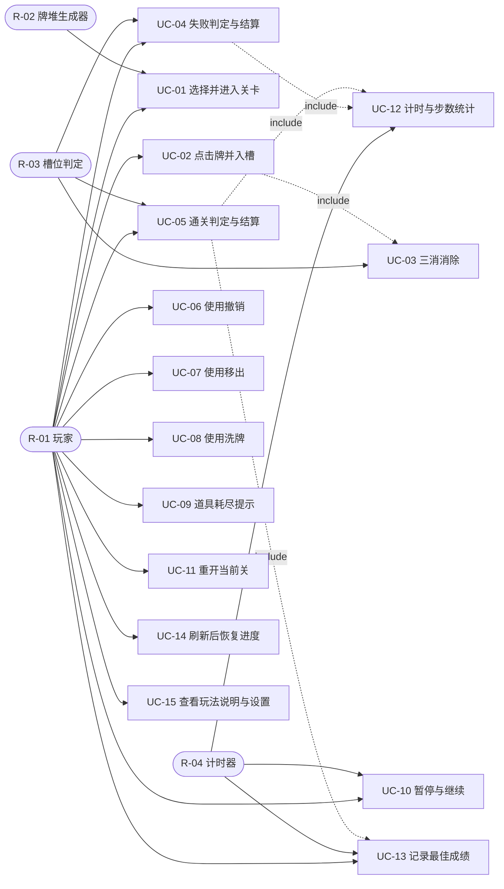

# 奶了个奶 — 需求分析文档

| 项 | 内容 |
|---|---|
| 文档编号 | 02 |
| 文档名称 | 需求分析文档（需求基线） |
| 项目名称 | 奶了个奶 —— 三消堆叠消除小游戏（Web 单页版） |
| 依据 | `docs/01-项目提示词.md` P01 · 项目设想 + P00 五项确认 |
| 技术约束 | 原生 HTML + CSS + JavaScript；DOM 绝对定位渲染；localStorage 存档；无框架、无构建、无网络请求 |
| 版本 | **v1.1（需求基线已冻结）** — 2026-10-31 经用户逐条确认 Q-01～Q-05 后修订，此后只允许通过"分析阶段遗留问题"流程提出变更 |
| 编写日期 | 2026-10-31 |
| 阶段 | 阶段一：需求分析（本阶段不写代码、不做系统设计） |

---

## 目录

1. [文档说明](#1-文档说明)
2. [角色分析](#2-角色分析)
3. [功能需求](#3-功能需求)
4. [业务规则](#4-业务规则)
5. [非功能需求](#5-非功能需求)
6. [用例分析](#6-用例分析)
7. [验收标准](#7-验收标准)
8. [需求追溯矩阵](#8-需求追溯矩阵)
9. [数据需求](#9-数据需求)
10. [待确认问题清单](#10-待确认问题清单)
11. [统计与自查](#11-统计与自查)

---

## 1. 文档说明

### 1.1 项目定位

「奶了个奶」是一款**单机、纯前端、本地存档**的三消堆叠消除小游戏：牌面由多层错位堆叠的图标牌组成，玩家只能点击未被上层遮挡的牌；点击后牌进入底部 7 格槽位，同图标凑满 3 张立即消除；槽位满 7 张且无法消除即失败，牌堆清空即通关。游戏提供三个难度关卡与三种道具（撤销、移出、洗牌），并记录每关的最佳用时与步数。

### 1.2 本期范围

三关难度配置与牌堆生成、遮挡判定与点击入槽、三消与失败/通关判定、三种道具与次数管理、计时步数、暂停重开、最佳记录、本地存档与设置项。

### 1.3 明确排除（本期不做）

| 排除项 | 说明 |
|---|---|
| 联网与排行榜 | 不上传成绩、不做好友对比、不发任何请求 |
| 账号与内购 | 无登录、无付费、无广告、无体力 |
| 玩家自制关卡 | 关卡为内置配置，不做关卡编辑器（列入展望） |
| 移动端适配 | 只保证桌面浏览器（1366×768 及以上）可用 |
| 真实美术资源 | 图标用内联 SVG 或字符图形，不引入图片文件 |

### 1.4 术语表

| 术语 | 说明 |
|---|---|
| 牌（Tile） | 一张带图标的可点击方块，有层号、格位、图标与状态 |
| 牌堆（Board） | 全部牌按层堆叠形成的整体，负责遮挡关系与坐标计算 |
| 层（Layer） | 牌堆的竖直分层，层号越大越靠上（越晚被覆盖） |
| 遮挡 | 某张牌的正上方有未消除的牌与其重叠，导致其不可点击 |
| 槽位（Tray） | 底部 7 格暂存区，依次接收点击的牌 |
| 三消 | 槽位中同一图标达到 3 张时一起消除 |
| 不变量 | 必须恒成立的约束，本项目的核心不变量是"每种图标的牌数 % 3 == 0" |
| 关卡（Level） | 一套配置：层数、每层布局、图标种类数、总牌数、道具次数 |
| 道具（Prop） | 撤销（Undo）、移出（Remove）、洗牌（Shuffle）三种干预手段 |
| 抖动（Jitter） | 同层牌在网格位置上的微小随机偏移，纯视觉，不参与判定 |
| 终局 | 失败或通关，此后禁止一切操作 |

---

## 2. 角色分析

### 2.1 角色清单

| 编号 | 角色名称 | 类型 | 描述 | 主要参与方式 |
|---|---|---|---|---|
| R-01 | 玩家 | 人参与者（唯一） | 本机使用者，拥有全部操作权限 | 选关、点牌、用道具、暂停、重开、查记录、改设置 |
| R-02 | 牌堆生成器 | 系统参与者 | 按关卡配置生成牌并对每张牌分配图标，保证数量不变量与可解性 | 进入关卡时被调用，产出牌堆 |
| R-03 | 槽位判定 | 系统参与者 | 判定入槽、三消、溢出与终局 | 每次入槽后被触发 |
| R-04 | 计时器 | 系统参与者 | 累计用时与步数 | 关卡进行中持续计时，暂停时冻结 |

> **说明**：R-02～R-04 不是"人"，而是参与用例的系统角色。列出它们的目的是明确**谁拥有判定权**：能不能点由牌堆说了算，能不能消由槽位说了算，用了多久由计时器说了算。这三条边界直接决定系统分析阶段的对象职责划分。

### 2.2 角色—功能域关系

图例：● 直接负责（主动发起或被直接调用）　○ 参与（作为数据源或被动执行）　— 不涉及

| 功能域 | R-01 玩家 | R-02 牌堆生成器 | R-03 槽位判定 | R-04 计时器 |
|---|---|---|---|---|
| 牌堆与关卡 | ● 选关、重开 | ● 生成牌堆 | — | — |
| 点击与消除 | ● 点击 | ○ 提供可点击性判定 | ● 判定三消与溢出 | — |
| 槽位与失败判定 | ○ 承担失败/通关后果 | — | ● 判定终局 | ○ 终局时停止计时 |
| 道具 | ● 使用道具 | ○ 洗牌时重排图标 | ○ 移出时回收槽位牌 | — |
| 记录与设置 | ● 查看记录、改设置 | — | — | ● 提供用时数据 |

---

## 3. 功能需求

编号规则：`FR-xx` 连续编号不跳号；优先级 **P0** = 缺失即无法演示、**P1** = 影响完整度、**P2** = 有余力再做。

### 3.1 牌堆与关卡（FR-01 ～ FR-06）

| 需求编号 | 需求名称 | 需求描述 | 优先级 | 涉及角色 |
|---|---|---|---|---|
| FR-01 | 关卡选择与进入 | 提供三个关卡入口（入门 / 进阶 / 挑战），可自由选择进入；显示每关是否已通关及最佳记录；进入后加载该关配置并生成牌堆 | P0 | R-01、R-02 |
| FR-02 | 多层堆叠牌堆展示 | 按层渲染全部牌，牌为绝对定位方块，同层网格排列、层间错位、上层覆盖下层；被覆盖的牌与可点的牌在视觉上可区分（压暗 + 不可点光标）；顶部 HUD 显示"剩余牌数"（牌堆中未消除牌数 + 槽位中牌数），随每次消除实时递减 | P0 | R-01、R-02 |
| FR-03 | 关卡配置与难度差异 | 三关由参数区分：入门 4 层 / 60 张 / 5 种图标；进阶 6 层 / 108 张 / 6 种图标；挑战 9 层 / 144 张 / 8 种图标；每关道具次数固定并写在配置中 | P0 | R-02 |
| FR-04 | 牌生成与数量不变量 | 生成时按"三张一组"投放图标，保证每种图标张数 % 3 == 0；生成后自检并断言，不满足则重新生成；洗牌后再次自检 | P0 | R-02 |
| FR-05 | 关卡重开 | 任意时刻（进行中、失败后、通关后）可重开当前关，二次确认后回到该关初始牌面，道具次数与计时步数归零 | P1 | R-01 |
| FR-06 | 牌面错位与抖动 | 同层牌在网格位置上带微小随机偏移（不超过牌宽的 1/6），使堆叠观感自然；抖动为纯视觉，不参与遮挡判定 | P2 | R-02 |

> **口径说明（来自 P00 第 1、3 问）**：抖动幅度只影响渲染坐标，判定用的格位坐标是整数网格，二者分离。挑战关的"恶意难度"通过**层数、遮挡密度、图标种类数**三个参数实现，同时仍保证"存在通关序列"（BR-12），因此它可以被通关但容错极低——这是可测试的，而不是真做成无解。

### 3.2 点击与消除（FR-07 ～ FR-11）

| 需求编号 | 需求名称 | 需求描述 | 优先级 | 涉及角色 |
|---|---|---|---|---|
| FR-07 | 可点击判定（遮挡判定） | 点击时先判定该牌是否被任何未消除的牌覆盖；未覆盖才允许入槽，覆盖则拒绝。判定只依赖模型数据（层号 + 格位），不依赖 DOM 或坐标几何 | P0 | R-01、R-02 |
| FR-08 | 点击入槽 | 合法点击后，牌从牌堆移除并追加到槽位末尾，播放飞入动画；一次点击为原子操作，失败则整体不生效 | P0 | R-01 |
| FR-09 | 三消消除 | 每次入槽后检测槽位中是否有同图标达到 3 张，有则立即消除这 3 张；消除后槽位保持原有排列顺序（不重排） | P0 | R-03 |
| FR-10 | 消除动画与连消反馈 | 三消时播放缩放淡出动画并给出可感知的反馈（动画/音效），动画期间忽略新的点击，避免重复入槽 | P1 | R-03 |
| FR-11 | 无效点击反馈 | 点击被覆盖的牌时给出明确反馈（牌体抖动 + 微弱提示音）；不改变任何状态、不增加步数 | P2 | R-01 |

### 3.3 槽位与失败判定（FR-12 ～ FR-15）

| 需求编号 | 需求名称 | 需求描述 | 优先级 | 涉及角色 |
|---|---|---|---|---|
| FR-12 | 槽位展示与入槽顺序 | 底部固定 7 格，从左到右按入槽先后排列；空格可见；槽位中牌数实时反映 | P0 | R-03 |
| FR-13 | 失败判定 | 当槽位达到 7 张且本次入槽未产生三消时判定失败；立即停止计时、锁定操作、弹出结算 | P0 | R-03 |
| FR-14 | 通关判定 | 当牌堆中最后一张牌被消除（牌堆与槽位均为空）时判定通关；立即停止计时、弹出结算 | P0 | R-03 |
| FR-15 | 结算界面 | 失败与通关共用一个结算弹窗，显示结果、本关用时、步数、所用道具次数；通关时额外显示最佳记录与"新纪录"标记；提供重开与返回选关按钮 | P1 | R-01 |

### 3.4 道具（FR-16 ～ FR-20）

| 需求编号 | 需求名称 | 需求描述 | 优先级 | 涉及角色 |
|---|---|---|---|---|
| FR-16 | 道具栏与次数显示 | 底部展示三个道具按钮，各自显示图标、名称与剩余次数；次数来自关卡配置 | P0 | R-01 |
| FR-17 | 撤销 | 回退最近一次操作（点击入槽或道具使用），把牌恢复到操作前的位置与状态，并归还该操作消耗的道具次数；撤销栈上限 30 步 | P0 | R-01 |
| FR-18 | 移出 | 把槽位中最早的 3 张牌按原图标移回牌堆最上层可点击位置，槽位剩余牌前移补位 | P0 | R-01 |
| FR-19 | 洗牌 | 保持所有牌的位置、层号、遮挡关系不变，仅重排未消除牌的图标；洗牌后自检不变量 | P0 | R-01 |
| FR-20 | 道具次数管理与耗尽提示 | 每次使用扣减一次，扣到 0 时按钮置灰并提示"次数已用完"；终局后所有道具不可用 | P1 | R-01 |

### 3.5 记录与设置（FR-21 ～ FR-26）

| 需求编号 | 需求名称 | 需求描述 | 优先级 | 涉及角色 |
|---|---|---|---|---|
| FR-21 | 计时 | 进入关卡即开始计时，按秒递增显示 mm:ss；暂停、结算时停止 | P0 | R-04 |
| FR-22 | 步数统计 | 每次成功入槽计 1 步；无效点击、使用道具不计入步数（道具使用另行记录） | P1 | R-04 |
| FR-23 | 暂停与继续 | 暂停时计时冻结、牌与道具均不可操作，界面遮罩；继续后计时从原值恢复，不出现时间跳变 | P1 | R-04、R-01 |
| FR-24 | 最佳记录 | 按关卡分别保存最短用时与最少步数，只在更优时更新；选关界面展示 | P1 | R-01 |
| FR-25 | 本地存档与刷新恢复 | 进行中的对局（牌堆、槽位、道具次数、用时、步数、关卡）、最佳记录、设置全部存 localStorage；刷新后完整恢复；存档带版本号 | P0 | R-01 |
| FR-26 | 设置与玩法说明 | 提供音效开关（默认开）、动画开关（默认开，"减少动效"用于低配机器）、玩法说明弹窗；设置持久化 | P2 | R-01 |

### 3.6 优先级统计

| 优先级 | 数量 | 编号 |
|---|---|---|
| P0 | 16 | FR-01、FR-02、FR-03、FR-04、FR-07、FR-08、FR-09、FR-12、FR-13、FR-14、FR-16、FR-17、FR-18、FR-19、FR-21、FR-25 |
| P1 | 7 | FR-05、FR-10、FR-15、FR-20、FR-22、FR-23、FR-24 |
| P2 | 3 | FR-06、FR-11、FR-26 |
| 合计 | 26 | FR-01 ～ FR-26（连续，无跳号） |

---

## 4. 业务规则

业务规则是**约束**而非功能：它们不属于任何单一按钮，但所有路径都必须遵守。本项目是全靠规则撑起来的游戏，规则写错就会变成"永远消不完"或"明明能消却判负"。

| 编号 | 规则名称 | 规则描述 | 关联需求 |
|---|---|---|---|
| BR-01 | 覆盖判定 | 一张牌可点击，当且仅当不存在"未消除且层号更高、格位与其重叠"的牌。判定只读模型（层号 + 整数格位），与渲染坐标、抖动、窗口缩放无关 | FR-07 |
| BR-02 | 槽位容量 | 槽位最多 7 张，按入槽顺序排列；达到 7 张时若本次入槽未消除则立即失败 | FR-12、FR-13 |
| BR-03 | 三消即时性 | 每次入槽后立即检测，同图标满 3 张就地消除；消除后不重排剩余牌顺序；一次入槽最多触发一次消除（三张同图标在语义上不可能同时凑出两组） | FR-09 |
| BR-04 | 数量不变量 | 每种图标的牌数必须是 3 的倍数；未消除牌总数必须是 3 的倍数。这条不变量必须在生成、移出、洗牌、撤销四条路径上恒成立 | FR-04、FR-18、FR-19、FR-17 |
| BR-05 | 道具不破坏不变量 | 移出只改变牌的位置与所在区域，不改变图标与数量；洗牌只重排图标，不改变位置与数量。两者执行后都必须重新自检 BR-04 | FR-18、FR-19 |
| BR-06 | 撤销语义 | 一次点击、一次道具使用都封装为一条可撤销命令；撤销后牌回到原位、道具次数归还；撤销栈上限 30，超出丢弃最旧；撤销本身不可再被撤销；终局后撤销不可用 | FR-17 |
| BR-07 | 移出落点规则 | 移出的 3 张牌放到牌堆**最上层**的空闲格位（优先与原有布局对齐），放回后立即可点击；若最上层无空闲格位，则在其上方新建一层放置 | FR-18 |
| BR-08 | 洗牌只换图标 | 洗牌不改变任何牌的层号、格位、是否被覆盖，只重新分配图标；洗牌不得使局面变得更不可解（只做图标置换，不改变结构） | FR-19 |
| BR-09 | 终局锁定 | 失败或通关后，点击、道具、暂停一律无效，仅允许"重开"与"返回选关"；计时立即停止 | FR-13、FR-14、FR-20 |
| BR-10 | 计时冻结 | 暂停期间计时不累加；恢复后从暂停时刻继续；结算后不再计时。实现上必须记录累计毫秒而非每秒自增，避免暂停造成漂移 | FR-21、FR-23 |
| BR-11 | 存档与恢复 | 存档只保存可重建状态的最小集合（不存 DOM、不存函数、不存类实例）；带版本号，版本不匹配时按默认值处理并提示；损坏时不得白屏 | FR-25 |
| BR-12 | 可解性保证 | 牌堆生成时按"三张一组"投放到同一可解序列，保证存在一种点击顺序可清空全部牌；挑战关不降低可解性，只提高"找到该顺序"的难度 | FR-04、FR-03 |
| BR-13 | 道具次数 | 每关道具次数固定写在关卡配置中（入门 3/2/2，进阶 2/1/1，挑战 1/1/1，依次为撤销/移出/洗牌）；仅重开会重置次数 | FR-16、FR-20、FR-05 |

---

## 5. 非功能需求

| 编号 | 类别 | 需求描述 | 验收关联 |
|---|---|---|---|
| NFR-01 | 运行环境 | 纯前端单页，双击 index.html 即可运行；支持 Chrome / Edge 最新版；无依赖、无构建、无网络请求 | AC-31 |
| NFR-02 | 性能 | 首屏 < 1.5 秒；点击到视觉反馈 < 100 毫秒；动画期间保持流畅（挑战关 144 张牌不掉帧） | AC-31、AC-32 |
| NFR-03 | 隐私 | 数据只写本机 localStorage，不上传、不埋点、不发请求 | AC-28 |
| NFR-04 | 容量 | 144 张牌 + 7 格槽位 + 30 步撤销栈的规模下，连续游玩 3 轮无卡顿、无内存增长异常 | AC-32 |
| NFR-05 | 可扩展性 | 新增图标只需在图标库加一项；新增关卡只需在关卡配置加一条；二者都不修改判定、渲染、撤销逻辑 | 见系统设计 |
| NFR-06 | 代码结构 | 模型（Tile/Board/Tray/Level）/ 引擎（Game/Undo/Prop/Timer/Generator）/ 数据（Repository）/ 表现（Renderer）四层分离；业务逻辑不碰 DOM | 见系统设计 |
| NFR-07 | 界面 | 中文界面；牌面带阴影与层级感；可点牌与不可点牌有双重区分（亮度 + 光标）；适配 1366×768 及以上 | AC-01、AC-06 |
| NFR-08 | 可测试性 | 覆盖判定、三消检测、失败判定、不变量自检均为纯函数/纯方法，可在浏览器控制台直接调用验证 | AC-04、AC-22、AC-14 |
| NFR-09 | 可读性 | 命名表意、单一职责、关键规则处注释"为什么"；能支撑报告中的类职责说明与代码走查 | 见代码走查 |

---

## 6. 用例分析

### 6.1 用例清单

| 编号 | 用例名称 | 参与者 | 关联需求 | 主流程要点 |
|---|---|---|---|---|
| UC-01 | 选择并进入关卡 | R-01、R-02 | FR-01、FR-02、FR-03、FR-06 | 选关 → 读配置 → 生成牌堆（含自检）→ 渲染 → 启动计时 |
| UC-02 | 点击牌并入槽 | R-01、R-03 | FR-07、FR-08、FR-12、FR-11 | 点击 → 覆盖判定 → 入槽 → 追加到槽位末尾 → 记录命令 |
| UC-03 | 三消消除 | R-03 | FR-09、FR-10 | 入槽后检测 → 同图标满 3 → 消除 → 播放动画 → 更新槽位 |
| UC-04 | 失败判定与结算 | R-03、R-01 | FR-13、FR-15 | 槽位满 7 且无消除 → 判负 → 停表 → 锁定 → 结算弹窗 |
| UC-05 | 通关判定与结算 | R-03、R-01 | FR-14、FR-15 | 牌堆与槽位均空 → 判胜 → 停表 → 比较记录 → 结算弹窗 |
| UC-06 | 使用撤销 | R-01 | FR-17 | 取栈顶命令 → 逆操作 → 归还次数 → 刷新 |
| UC-07 | 使用移出 | R-01 | FR-18 | 取槽位最早 3 张 → 放到牌堆最上层 → 自检不变量 → 生成命令 |
| UC-08 | 使用洗牌 | R-01 | FR-19 | 收集未消除图标 → 重排 → 回填 → 自检不变量 → 生成命令 |
| UC-09 | 道具耗尽提示 | R-01 | FR-16、FR-20 | 次数为 0 → 置灰 → 点击提示"次数已用完" |
| UC-10 | 暂停与继续 | R-01、R-04 | FR-23 | 暂停 → 冻结计时与操作 → 继续 → 恢复计时 |
| UC-11 | 重开当前关 | R-01 | FR-05 | 二次确认 → 重置牌堆/槽位/道具/计时 → 重新生成 |
| UC-12 | 计时与步数统计 | R-04 | FR-21、FR-22 | 进关启动 → 每秒刷新 → 入槽计步 → 终局停止 |
| UC-13 | 记录最佳成绩 | R-01、R-04 | FR-24 | 通关 → 比较用时/步数 → 更优则更新 → 标记新纪录 |
| UC-14 | 刷新后恢复进度 | R-01 | FR-25 | 加载 → 读存档 → 校验版本 → 重建对象 → 恢复界面 |
| UC-15 | 查看玩法说明与设置 | R-01 | FR-26 | 打开弹窗 → 切换音效/动效 → 保存设置 |

### 6.2 关键用例详述

#### UC-02 点击牌并入槽

| 项 | 内容 |
|---|---|
| 参与者 | R-01 玩家（主）、R-03 槽位判定 |
| 前置条件 | 游戏处于"进行中"状态；牌堆非空 |
| 后置条件 | 牌从牌堆移到槽位末尾；步数 +1；生成 1 条撤销命令；可能触发 UC-03 或 UC-04 |

**主流程**

1. 玩家点击一张牌。
2. 系统把点击位置映射到具体牌对象（由视图给出 tileId，不由视图判定可否点击）。
3. 系统调用牌堆的覆盖判定：该牌是否被任何未消除的高层重叠牌覆盖。
4. 判定通过，牌从牌堆移除，追加到槽位末尾。
5. 系统检测槽位中同图标是否达到 3 张。
6. 未达 3 张：牌面与槽位刷新，步数 +1，生成"入槽命令"压栈。
7. 达到 3 张：转 UC-03 执行消除，然后再刷新与计步。

**分支与异常**

| 编号 | 触发条件 | 系统处理 |
|---|---|---|
| 3a | 牌被覆盖 | 拒绝入槽，触发 FR-11 反馈（抖动），状态与步数不变 |
| 1a | 终局后点击 | 一切点击无效（BR-09） |
| 2a | 动画进行中连点 | 忽略本次点击，避免重复入槽 |
| 7a | 消除后槽位恰好清空且牌堆为空 | 转 UC-05 通关 |

#### UC-03 三消消除

| 项 | 内容 |
|---|---|
| 参与者 | R-03 槽位判定 |
| 前置条件 | 槽位中存在某图标恰好 3 张 |
| 后置条件 | 该 3 张牌消失；槽位长度 -3；剩余牌保持原相对顺序 |

**主流程**

1. 入槽完成后，系统按图标统计槽位中的张数。
2. 找到计数为 3 的图标，取出这 3 张牌。
3. 标记为"已消除"，从槽位移除。
4. 播放消除动画并给出反馈（音效受设置开关控制）。
5. 动画结束前屏蔽点击；结束后刷新槽位与牌堆的可点击态。

**分支与异常**

| 编号 | 触发条件 | 系统处理 |
|---|---|---|
| 1a | 无图标达到 3 张 | 直接返回，槽位保持 |
| 2a | 动效开关关闭 | 跳过动画，直接消除（逻辑不变，仅表现不同） |
| 4a | 消除后牌堆与槽位均为空 | 触发 UC-05 |

#### UC-06 使用撤销

| 项 | 内容 |
|---|---|
| 参与者 | R-01 玩家 |
| 前置条件 | 撤销栈非空；撤销次数 > 0；未终局 |
| 后置条件 | 画面回到上一步之前；撤销次数 -1；若被撤销的是道具操作，该道具次数 +1 |

**主流程**

1. 玩家点击撤销按钮。
2. 系统取栈顶命令，判断其类型（入槽 / 移出 / 洗牌）。
3. 执行该命令的逆操作：牌回到牌堆原层原格位、槽位恢复、图标恢复。
4. 归还该命令涉及的资源：若栈顶是道具命令，则对应道具次数 +1。
5. 撤销次数 -1，弹出该命令。
6. 刷新牌堆可点击态、槽位、HUD（步数不回退，步数是"行动记录"不是"状态"）。

**分支与异常**

| 编号 | 触发条件 | 系统处理 |
|---|---|---|
| 1a | 撤销次数为 0 | 按钮置灰，点击无效 |
| 1b | 撤销栈为空（例如刚进关） | 按钮置灰，提示"没有可撤销的操作" |
| 3a | 撤销后局面回到"槽位满但未判负"的中间态 | 允许（撤销不改变已发生的终局判定；终局后本按钮不可用） |

#### UC-14 刷新后恢复进度

| 项 | 内容 |
|---|---|
| 参与者 | R-01 玩家 |
| 前置条件 | 存在存档 |
| 后置条件 | 牌堆、槽位、道具次数、用时、步数、关卡与刷新前一致 |

**主流程**

1. 页面加载，系统读取存档。
2. 校验版本号与结构完整性。
3. 版本匹配：重建 Tile / Board / Tray 实例（不是直接塞回对象字面量）。
4. 恢复计时基准（累计毫秒 + 恢复时刻），继续计时。
5. 渲染界面并恢复可点击态与道具按钮状态。

**分支与异常**

| 编号 | 触发条件 | 系统处理 |
|---|---|---|
| 1a | 无存档 | 进入选关界面 |
| 2a | 版本不匹配 | 丢弃存档，进入选关界面并提示"存档版本不兼容，已重置" |
| 2b | 结构损坏（JSON 解析失败） | 同上，且不得白屏 |

### 6.3 用例图

**图示说明**

| 关系 | 说明 |
|---|---|
| UC-02 include UC-03 | 入槽之后**必然**要做三消检测，二者不是可选关系；把三消独立成用例是为了让"判定归槽位"这条职责边界显式化 |
| UC-04 / UC-05 include UC-12 | 结算必须显示用时与步数，故两个终局用例都依赖计时统计 |
| UC-05 include UC-13 | 通关才可能刷新最佳记录；失败关不写记录 |

> 这四条 include 关系导出系统分析的两个结论：**判定权归模型**（覆盖归牌堆、三消与终局归槽位），**结算与记录分离**（结算是展示，记录是持久化，两者不在同一个对象里）。

---

## 7. 验收标准

每条按"操作步骤 → 预期结果"编写，可由人工在不看代码的情况下判定。

| 编号 | 对应需求 | 操作步骤 | 预期结果 |
|---|---|---|---|
| AC-01 | FR-02 | 打开页面并进入入门关 | 看到四层错位堆叠的牌，牌之间有重叠、有立体层级感；被压住的牌明显更暗 |
| AC-02 | FR-01 | 在选关界面分别点入门 / 进阶 / 挑战 | 三次都能进入对应关卡，顶部显示关卡名；返回选关后按钮状态正常 |
| AC-03 | FR-03 | 三关各进入一次，数牌 | 总牌数分别为 60 / 108 / 144；层数为 4 / 6 / 9；道具次数与配置一致 |
| AC-04 | FR-04 | 在控制台调用不变量自检 | 返回 true；打印每种图标张数，均为 3 的倍数，总和等于总牌数 |
| AC-05 | FR-06 | 观察同层牌的排布 | 同层牌呈网格排列但各自有微小偏移，无两张完全重合，整体观感自然不呆板 |
| AC-06 | FR-07 | 点击一张明显被上层压住的牌 | 牌不移动、不进入槽位，只有抖动反馈；步数不变 |
| AC-07 | FR-07 | 点击一张完全露出的顶层牌 | 该牌飞入槽位，牌堆中消失，其下方被它压住的牌立即变为可点（变亮） |
| AC-08 | FR-08 / FR-12 | 连续点三张不同图标的可点牌 | 槽位从左到右依次出现三张牌，空格仍在右侧 |
| AC-09 | FR-09 | 点三张同图标的可点牌 | 第三张入槽后，三张一起消除，槽位恢复空 |
| AC-10 | FR-09 | 槽位已有 2 张同图标时，点第 3 张同图标 | 立即消除，槽位中这三张消失，其余牌位置前移 |
| AC-11 | FR-10 | 触发三消时快速连点其他牌 | 消除动画期间点击被忽略，不会出现同一张牌入槽两次 |
| AC-12 | FR-11 | 连续点击被压住的牌 3 次 | 每次都出现抖动反馈（若音效开启还有提示音），步数始终不变 |
| AC-13 | FR-13 | 把 7 张互不同图标的牌放入槽位 | 第 7 张入槽后立即弹出失败弹窗；之后再点牌无效，计时停止 |
| AC-14 | FR-13 | 让第 7 张牌恰好凑成三消 | 不判负：三张消除后槽位变为 4 张，游戏继续 |
| AC-15 | FR-14 | 清空牌堆全部牌 | 最后一张消除后立即弹出通关弹窗，计时停止 |
| AC-16 | FR-15 | 制造一次失败 | 弹窗显示"失败"、用时、步数、道具使用情况，含"重开"与"返回选关"按钮，两按钮都能用 |
| AC-17 | FR-15 | 通关一次 | 弹窗显示"通关"、用时、步数，并显示本关最佳记录；若刷新记录则出现"新纪录"标记 |
| AC-18 | FR-16 | 观察底部道具栏 | 三个道具图标、名称与剩余次数均可见，且与关卡配置一致 |
| AC-19 | FR-17 | 点 6 张牌后点撤销 | 最后入槽的那张牌回到牌堆原位（原来层与格位），槽位少一张；撤销次数 -1 |
| AC-20 | FR-17 | 连续撤销直到次数为 0 | 次数归零后按钮置灰，再点无效并提示"次数已用完" |
| AC-21 | FR-18 | 槽位有 3 张牌时点移出 | 这 3 张按原图标回到牌堆最上层，立即可点击；槽位剩下的牌前移补位 |
| AC-22 | FR-19 | 记录洗牌前每张牌的层号与格位，点洗牌后对比 | 位置、层号、遮挡关系完全不变，仅图标发生变化；控制台自检不变量仍为 true |
| AC-23 | FR-18 / BR-04 | 用移出后再用洗牌，再撤销两次 | 两次撤销后牌堆、槽位、道具次数三者都回到用道具之前，且不变量仍成立 |
| AC-24 | FR-20 | 把某个道具用到 0 次 | 按钮立即置灰；再点提示"次数已用完"；其他道具不受影响 |
| AC-25 | FR-21 | 进入关卡后等待 10 秒 | 计时显示从 00:00 递增到 00:10 左右，与实际秒数一致 |
| AC-26 | FR-22 | 点击 5 张可点牌，再点击 2 张被压住的牌 | 步数显示为 5；无效点击不增加步数 |
| AC-27 | FR-23 | 游玩 20 秒后点暂停，等待 10 秒，再继续 | 暂停期间计时停在 00:20 不动，牌不可点；继续后从 00:20 接着走，无跳变 |
| AC-28 | FR-25 | 玩到一半刷新页面 | 牌堆、槽位、道具次数、用时、步数、当前关卡全部恢复，与刷新前一致 |
| AC-29 | FR-24 | 先通关一次，再以更差成绩通关同一关 | 最佳记录保持第一次的较优值，不被覆盖；选关界面显示该记录 |
| AC-30 | FR-26 | 打开设置，关闭音效，再刷新 | 音效开关状态被记住；关闭后点击与消除不再有声音，但逻辑与动画正常 |
| AC-31 | NFR-01 / NFR-02 | 打开页面记录首屏时间；点击一张牌记录反馈时间 | 首屏 < 1.5 秒；点击到牌开始移动 < 100 毫秒；控制台无报错、无网络请求 |
| AC-32 | NFR-04 | 挑战关连玩 3 轮（含失败与重开） | 无卡顿、无内存明显增长、无异常报错 |
| AC-33 | BR-12 | 对三关各跑一次自动求解（或人工按已知序列点完） | 三关均存在可清空的点击序列，验证可解性保证成立 |
| AC-34 | FR-02 | 进入关卡后观察顶部 HUD，然后点掉三张同图标牌 | HUD 剩余牌数每次消除准确减少 3，入槽时不变、消除时才变；重开后恢复为满值；数字与"牌堆剩余 + 槽位剩余"始终相等 |

---

## 8. 需求追溯矩阵

### 8.1 正向追溯：需求 → 用例 → 验收

| 需求 | 承接用例 | 验收标准 |
|---|---|---|
| FR-01 | UC-01 | AC-02 |
| FR-02 | UC-01 | AC-01、AC-34 |
| FR-03 | UC-01 | AC-03 |
| FR-04 | UC-01 | AC-04、AC-33 |
| FR-05 | UC-11 | AC-16（重开按钮） |
| FR-06 | UC-01 | AC-05 |
| FR-07 | UC-02 | AC-06、AC-07 |
| FR-08 | UC-02 | AC-08 |
| FR-09 | UC-03 | AC-09、AC-10 |
| FR-10 | UC-03 | AC-11 |
| FR-11 | UC-02 | AC-12 |
| FR-12 | UC-02 | AC-08 |
| FR-13 | UC-04 | AC-13、AC-14 |
| FR-14 | UC-05 | AC-15 |
| FR-15 | UC-04、UC-05 | AC-16、AC-17 |
| FR-16 | UC-09 | AC-18 |
| FR-17 | UC-06 | AC-19、AC-20 |
| FR-18 | UC-07 | AC-21、AC-23 |
| FR-19 | UC-08 | AC-22、AC-23 |
| FR-20 | UC-09 | AC-24 |
| FR-21 | UC-12 | AC-25 |
| FR-22 | UC-12 | AC-26 |
| FR-23 | UC-10 | AC-27 |
| FR-24 | UC-13 | AC-29 |
| FR-25 | UC-14 | AC-28 |
| FR-26 | UC-15 | AC-30 |

### 8.2 反向核查：用例 → 需求

| 用例 | 覆盖需求 |
|---|---|
| UC-01 | FR-01、FR-02、FR-03、FR-04、FR-06 |
| UC-02 | FR-07、FR-08、FR-11、FR-12 |
| UC-03 | FR-09、FR-10 |
| UC-04 | FR-13、FR-15 |
| UC-05 | FR-14、FR-15 |
| UC-06 | FR-17 |
| UC-07 | FR-18 |
| UC-08 | FR-19 |
| UC-09 | FR-16、FR-20 |
| UC-10 | FR-23 |
| UC-11 | FR-05 |
| UC-12 | FR-21、FR-22 |
| UC-13 | FR-24 |
| UC-14 | FR-25 |
| UC-15 | FR-26 |

### 8.3 业务规则与验收的对应

| 业务规则 | 验收标准 |
|---|---|
| BR-01 | AC-06、AC-07 |
| BR-02 | AC-08、AC-13 |
| BR-03 | AC-09、AC-10、AC-14 |
| BR-04 | AC-04、AC-23、AC-33 |
| BR-05 | AC-21、AC-22 |
| BR-06 | AC-19、AC-20、AC-23 |
| BR-07 | AC-21 |
| BR-08 | AC-22 |
| BR-09 | AC-13、AC-16 |
| BR-10 | AC-27 |
| BR-11 | AC-28 |
| BR-12 | AC-33 |
| BR-13 | AC-03、AC-24 |

---

## 9. 数据需求

需要持久化到 localStorage 的对象及其关键属性：

| 对象 | 关键属性 | 说明 |
|---|---|---|
| SaveGame | version、levelId、status（进行中/失败/通关）、tiles[]、tray[]、props{undo, remove, shuffle}、elapsedMs、steps、savedAt | 进行中对局的完整快照 |
| TileRecord | id、icon、layer、col、row、jitterX、jitterY、state（board/tray/cleared） | 单张牌的存档形态（普通对象，不含方法） |
| Records | 按 levelId 分组：bestTimeMs、bestSteps、clearedTimes | 最佳记录，只保留更优值 |
| Settings | soundOn、reduceMotion | 设置项 |
| LevelConfig | id、name、layers、cols、rows、iconKinds、iconCountPerKind、props{undo,remove,shuffle} | 三关配置（静态数据，代码内置） |
| 撤销栈 | 不持久化 | 刷新后从空栈开始（避免撤销跨越刷新导致的语义混乱） |

**派生约束（写入代码自检）**

| 关卡 | 总牌数 | 图标种类 | 每种张数 | 组数 | 层数 | 道具（撤销/移出/洗牌） |
|---|---|---|---|---|---|---|
| 入门 | 60 | 5 | 12 | 20 | 4 | 3 / 2 / 2 |
| 进阶 | 108 | 6 | 18 | 36 | 6 | 2 / 1 / 1 |
| 挑战 | 144 | 8 | 18 | 48 | 9 | 1 / 1 / 1 |

> 校验：每种张数 12、18、18 均为 3 的倍数；总牌数 60、108、144 均为 3 的倍数；组数 × 3 = 总牌数，三关均成立。

---

## 10. 待确认问题清单

> **状态（2026-10-31 更新）**：Q-01～Q-05 已由用户逐条确认，下表"结论"列即冻结后的口径。"建议"列保留，用于对照决策过程。

| 编号 | 问题 | 影响范围 | 建议（原） | 结论（已确认，v1.1） |
|---|---|---|---|---|
| Q-01 | 挑战关的"恶意难度"到什么程度？ | BR-12、FR-03、AC-33 | 保证有解 + 极低容错 | **采纳**：保证存在通关序列（BR-12），容错极低；不做"必须用道具才有解"——后者无法客观验收 |
| Q-02 | 音效是否要做？ | FR-26、FR-10、FR-11 | 做，最后做 | **做**：WebAudio 合成、设置可关，作为迭代 6 的打磨项；不阻塞任何 P0 |
| Q-03 | 通关后是否提供"下一关"衔接按钮？ | FR-15 | 只给重开 / 返回选关 | **采纳**：只给"重开 / 返回选关"，避免关卡顺序解锁的隐含依赖 |
| Q-04 | 是否显示"剩余牌数 / 可点击牌数"提示？ | FR-02、FR-03 | 不显示 | **显示剩余牌数**（改建议）：并入 FR-02 的需求描述，新增验收 AC-34；仍不显示"可点击牌数" |
| Q-05 | 撤销后步数是否回退？ | FR-22、BR-06 | 不回退 | **采纳**：步数是累计行动数，不回退 |

**Q-04 的追加影响（已并入基线）**

| 项 | 内容 |
|---|---|
| 定义 | 剩余牌数 = 牌堆中未消除牌数 + 槽位中牌数；入槽不改变总数，消除时才减少 |
| 归属 | 并入 FR-02（牌堆展示），**不新增 FR 编号**，避免 26 条需求的编号整体漂移 |
| 新增验收 | AC-34（消除时准确减 3；重开恢复满值；数字与"牌堆剩余 + 槽位剩余"始终相等） |
| 难度影响 | 显示剩余牌数会降低信息不确定性，但挑战关的难度来自"遮挡顺序"而非"还剩多少张"，故不影响 Q-01 的容错极低口径；"可点击牌数"才是真正的难度泄漏，已明确不显示 |

---

## 11. 统计与自查

### 11.1 数量统计

| 类别 | 数量 | 编号范围 |
|---|---|---|
| 角色 | 4 | R-01 ～ R-04 |
| 功能需求 FR | 26 | FR-01 ～ FR-26（连续无跳号） |
| 业务规则 BR | 13 | BR-01 ～ BR-13 |
| 非功能需求 NFR | 9 | NFR-01 ～ NFR-09 |
| 用例 UC | 15 | UC-01 ～ UC-15 |
| 验收标准 AC | 34 | AC-01 ～ AC-34 |
| 待确认问题 Q | 5 | Q-01 ～ Q-05 |

### 11.2 优先级分布

| 优先级 | 数量 | 编号 |
|---|---|---|
| P0 | 16 | FR-01、FR-02、FR-03、FR-04、FR-07、FR-08、FR-09、FR-12、FR-13、FR-14、FR-16、FR-17、FR-18、FR-19、FR-21、FR-25 |
| P1 | 7 | FR-05、FR-10、FR-15、FR-20、FR-22、FR-23、FR-24 |
| P2 | 3 | FR-06、FR-11、FR-26 |

### 11.3 覆盖性自查

| 自查项 | 结论 | 依据 |
|---|---|---|
| 每个 FR 是否至少被一个 UC 覆盖 | **通过**，26/26 全覆盖 | 见 8.1、8.2 |
| 每个 FR 是否至少被一个 AC 覆盖 | **通过**，26/26 全覆盖 | 见 8.1；FR-04、FR-13、FR-15、FR-17、FR-18、FR-19 各由两条以上 AC 覆盖 |
| 每个 UC 是否至少承接一个 FR | **通过**，15/15 均有承接 | 见 8.2 |
| 是否存在无需求的孤立用例 | **无** | 8.2 中每个 UC 均列出所覆盖 FR |
| 是否存在无用例承接的孤立需求 | **无** | 8.1 中每个 FR 均有 UC |
| 11 条指定业务规则是否全部落表 | **通过** | 覆盖判定 BR-01、槽位容量 BR-02、三消即时 BR-03、3 的倍数 BR-04、道具不破坏不变量 BR-05、撤销语义 BR-06、移出落点 BR-07、洗牌只换图标 BR-08、终局禁止操作 BR-09、计时暂停停止 BR-10、存档恢复 BR-11；另补 BR-12 可解性保证、BR-13 道具次数 |
| "3 的倍数"不变量是否每条相关路径都对齐 | **通过**，四条路径全覆盖 | 生成 BR-04、移出 BR-05、洗牌 BR-05 + BR-08、撤销 BR-06（命令逆操作天然保持数量）；验收对应 AC-04、AC-22、AC-23、AC-33 |
| P0 是否"缺了就演示不了" | **通过**，逐条复核 | FR-01/02/03 无牌堆则无内容；FR-04 无数量保证则牌永远消不完；FR-07/08 无判定的点击等于无游戏；FR-09 无三消则无核心玩法；FR-12/13/14 无槽位与终局则游戏无法结束；FR-16/17/18/19 道具是三类核心机制且 P0 中占 4 条（因道具直接改变局面，缺失则演示不完整）；FR-21 无计时则无成绩；FR-25 无存档则刷新即丢，无法作为"作品"使用 |
| 验收标准是否可人工勾选 | **通过**，34 条均为"操作步骤 + 预期结果" | 第 7 章 |
| 数值是否自洽 | **通过** | 60=20×3、108=36×3、144=48×3；每种张数 12/18/18 均为 3 的倍数（第 9 章已验算） |

### 11.4 本阶段遗留风险

| 风险 | 说明 | 处理方式 |
|---|---|---|
| 验收标准与需求条数 | 34 条 AC 覆盖 26 条 FR | FR-02 现由 AC-01 与 AC-34 两条覆盖（后者为 Q-04 追加） |
| Q-01～Q-05 已确认（v1.1） | 结论已并入基线：Q-01 维持可解性保证、Q-02 做音效（迭代 6）、Q-03 仅重开/返回、Q-04 显示剩余牌数（新增 AC-34）、Q-05 步数不回退 | 基线冻结；后续变更须走"分析阶段遗留问题"流程，不得直接改需求 |
| 可解性"经验保证" | BR-12 靠"三张一组投放"实现，理论上仍可能出现"三张被压在不同深层、顺序极端"的局面 | 系统设计阶段给出更强的构造（按可解序列反向铺牌），并在 AC-33 用求解器验证 |
| 撤销与终局的关系 | 终局后撤销被禁用，但"刷新后撤销栈被清空"意味着终局不可逆 | 已写入 BR-06 与第 9 章，系统设计阶段确认是否合理 |
| 挑战关难度可测性 | "恶意"难以客观验收 | 已把它翻译成三个可量化参数（层数 9 / 144 张 / 8 种图标）+ 可解性断言，避免主观争论 |
