# 奶了个奶 —— 基于 AI 分步协作的三消堆叠消除游戏

> 课程：《面向对象设计与分析》 ｜ 开发方式：AI 编程代理分阶段协作（P00～P10 提示词驱动） ｜ 完成时间：2026-11-01

| 项目 | 内容 |
|---|---|
| 程序形态 | 纯前端单页应用，双击 `nailegenai/index.html` 直接运行 |
| 代码规模 | 42 个源文件、5981 行（其中非空非注释 4390 行）、素材 17 个文件约 1.7 MB |
| 交互记录 | 21 条（`docs/07-AI交互记录.md` 的 R-01～R-21） |
| 过程文档 | 需求分析、系统分析、系统设计、开发计划、交互记录共 5 份 + 6 张 PlantUML 图 |
| 本文对应要求 | 第 1 章项目概况 ｜ 第 3 章 AI 开发过程（≫50%） ｜ 第 4 章 人工测试过程 ｜ 第 5 章 总结与展望 ｜ 附录 |

---

# 第 1 章 项目概况

## 1.1 选题理由

我选"三消堆叠消除"（机制同《羊了个羊》）而不是课程里常见的五子棋，原因是这两类题目的**难点位置完全不同**。

五子棋的难点在"规则"：判五连、判禁手、判胜负，规则本身是清楚的一条条，写错了跑一局就能看出来。它的对象关系也简单——棋盘、棋子、玩家、规则，几乎是一张平面图。而三消堆叠消除的规则只有三句话（点没被压住的牌、同图标满三张消除、槽位满七张失败），难点却全在**状态**上：

1. **遮挡关系是全局的**。一张牌能不能点，不取决于它自己，而取决于"有没有别的牌压在它上面"。这条性质不属于任何一张牌，必须有一个对象专门持有它——这就是我后来把"覆盖判定"收进 `Board` 而不是塞进 `Tile` 的直接原因。
2. **一个动作会同时改三个地方**。点一下牌，牌堆少一张、槽位多一张、可能还有三张被消掉、可能还判定失败、可能还要记一条可撤销命令。这五个后果必须**同时生效或同时不生效**，否则玩家会看到"牌进了槽位但没计步"这种鬼现象。
3. **存在"数量必须守恒"的硬约束**。每种图标的牌数必须始终是 3 的倍数，否则最后会剩一两张永远消不掉——而这种错**不会报错**，只会表现为"这局打不完"。这类不变量必须在生成、移出、洗牌、撤销四条路径上同时守住。

**与课程五子棋例子的差别**可以概括成一张表：

| 维度 | 五子棋 | 奶了个奶 |
|---|---|---|
| 状态维度 | 棋盘格（二维） | 层号 × 格位（三维，含遮挡偏序） |
| 对象间关系 | 棋子 ⊂ 棋盘（组合） | 牌 ⊂ 牌堆、牌 ⊂ 槽位（同一张牌在容器间迁移） |
| 硬约束 | 落子位置合法 | 3 的倍数不变量、槽位容量 7、层号范围 |
| 动作的失败面 | 落子非法即拒绝 | 一次点击可能同时触发入槽、消除、失败判定 |
| 可撤销性 | 通常不做 | 必须做，且道具也要能撤销 |

所以这个题目虽然"小"，但它逼着我把**职责边界**和**不变量**这两件事想清楚——这正好是这门课要我练的东西。

## 1.2 项目简介

一句话定位：**一款可以在浏览器里双击打开、离线可玩、能存档、有三个难度和三种道具的三消堆叠消除小游戏**。

- 三个关卡：入门 4 层 60 张 / 进阶 6 层 108 张 / 挑战 6 层 144 张，图标种类依次 10 / 12 / 16 种。
- 三种道具：撤销（回退一步，道具自身也能被撤销）、移出（把槽位最前面几张牌拿到暂存区，随时点回槽位）、洗牌（只换图标、不动位置）。
- 记录与流程：计时、步数、按关卡分别保存最佳记录、暂停、二次确认重开、玩法说明与设置（音效开关、减少动效）。
- 本地存档：进行中的对局、最佳记录、设置全部存 `localStorage`，刷新后接着玩。

## 1.3 运行环境

| 项 | 要求 / 说明 |
|---|---|
| 运行方式 | 双击 `nailegenai/index.html`；无需安装、无需构建、无需服务器 |
| 浏览器 | Chrome / Edge 最新版（使用了 `:root` 自定义属性、CSS 动画、WebAudio） |
| 网络 | **完全不发请求**：图标、背景图、脚本、样式全部本地文件 |
| 存储 | `localStorage` 三个键，不上传、不埋点 |
| 分辨率 | 1280×720 以上体验最佳；窗口缩放时舞台按 `min` 比例自适应 |

## 1.4 功能展示

以下截图全部来自实际运行的程序（由无头浏览器渲染真实页面取得，非手绘）。

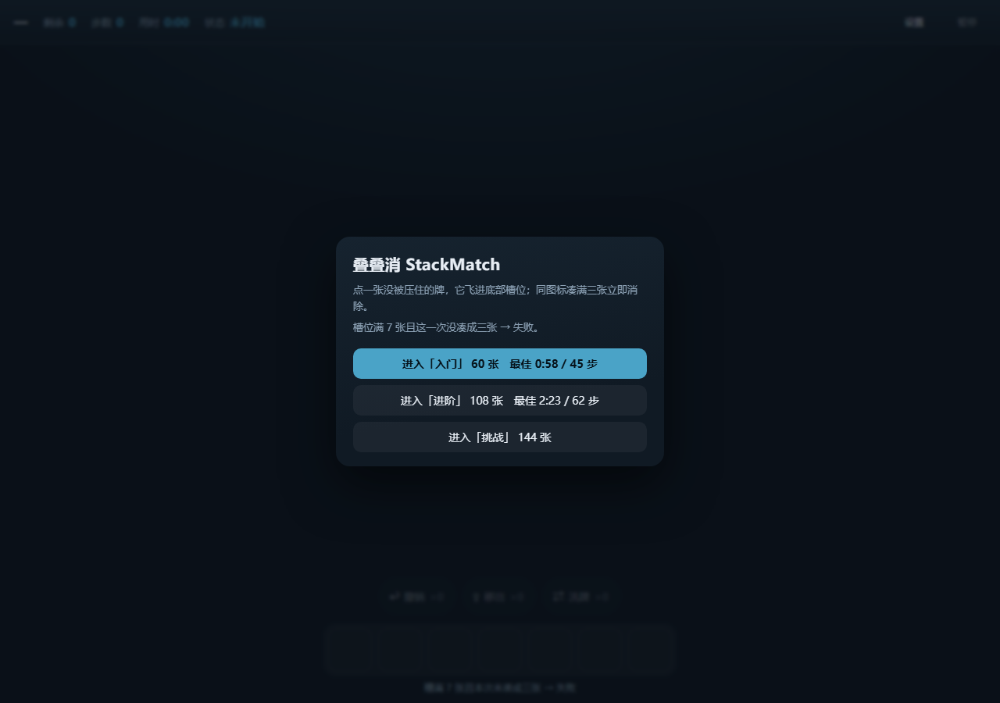

**图 1-1　选关界面**：三个关卡按钮上直接显示该关的最佳记录（用时 + 步数），说明"最佳记录按关卡分别保存、只在更优时更新"这条需求确实落到了界面上。

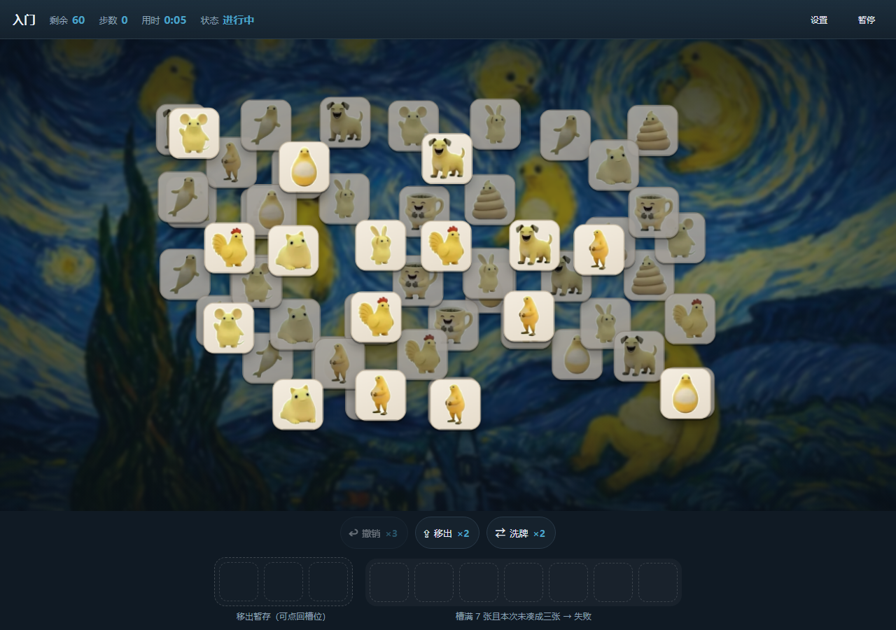

**图 1-2　对局界面**：牌堆由多层错位堆叠的牌组成，被压住的牌整体压暗、可点的牌明亮；底部是道具条与 7 格槽位。这张图说明了"同一张牌在牌堆里是一个状态、进槽位是另一个状态"的两个视觉分区。

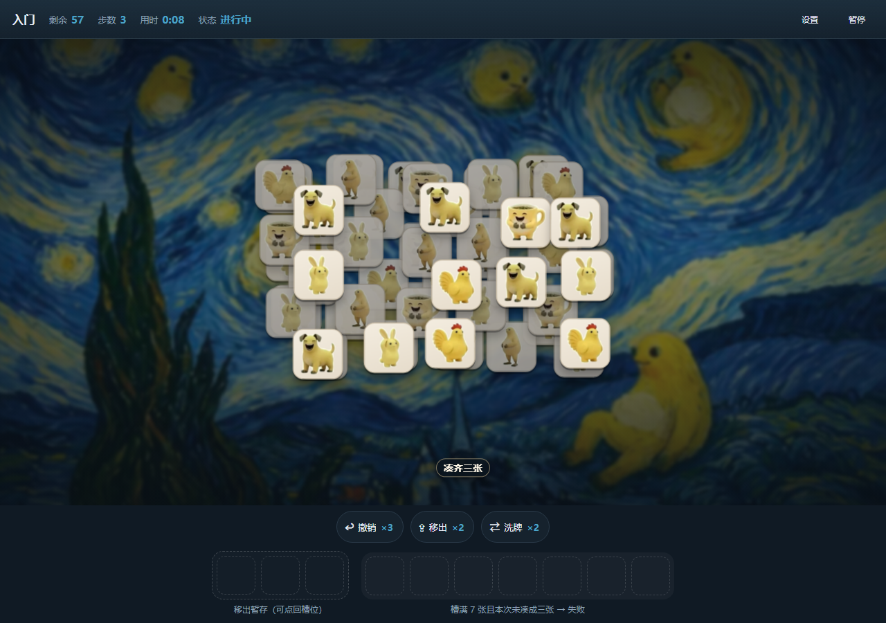

**图 1-3　三消反馈**：同图标第三张入槽时，槽位上方飘出"凑齐三张"提示。这张图说明"消除"这个动作除了改状态，还必须给玩家一个可感知的确认。

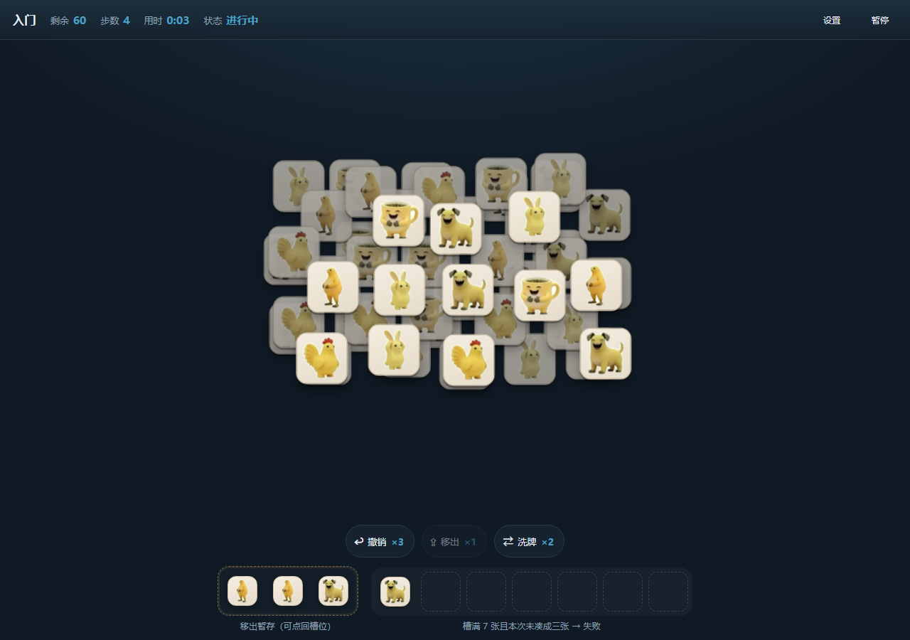

**图 1-4　移出到暂存区**：用"移出"后，槽位最前面的三张牌被拿到左下角的暂存区（可随时点回槽位），道具条上"移出"由 ×2 变为 ×1。这张图说明道具是**改变位置而不改变数量**的操作。

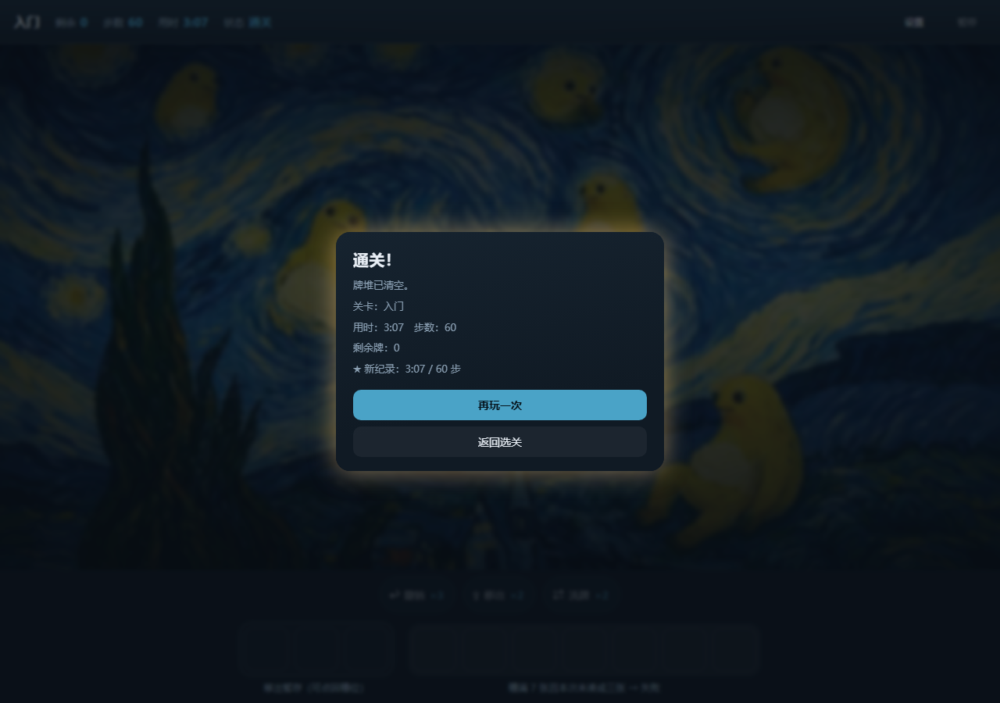

**图 1-5　通关结算**：显示用时、步数、剩余牌数，并在破纪录时标出"★ 新纪录"。这张图说明"结算"与"记录"是两件事：结算只报事实，记录另存一份。

## 1.5 已知限制

| 编号 | 限制 | 影响 |
|---|---|---|
| L-1 | 关卡可解性是"构造性保证"，不是运行时求解器验证 | 生成器保证存在通关序列（AC-33 可验证），但不保证玩家一定找得到 |
| L-2 | 洗牌只做"整组置换图标"，不保证洗后局面更好 | 洗牌是救急道具，可能出现"洗了还是难" |
| L-3 | 动画时长与缓动写死在 CSS/常量里 | 低配机上 144 张牌的错峰动画可能掉帧，只能靠"减少动效"开关规避 |
| L-4 | 未做移动端适配 | 手机上 7 格槽位 + 暂存区会换行，触控热区偏小 |
| L-5 | 存档不保存撤销栈 | 刷新后撤销按钮置灰，界面会提示一句（设计上的取舍，见 DD-06） |
| L-6 | 生成的牌面每次开局不同 | 同一关卡两次进入不是同一局，不适合"背板通关" |

---

# 第 3 章 AI 开发过程

## 3.1 需求分析

### 3.1.1 起始提示词（P00）

我先用一条"启动约束"把 AI 的边界框住：**这一轮不准写代码、不准写需求**，只准复述理解、列核心对象、提问题。

> 你是面向对象项目开发助手。我们要一起完成《面向对象设计与分析》课程大作业：开发一个"三消堆叠消除"小游戏（机制同《羊了个羊》），纯前端实现。
>
> 【技术约束】
> - 原生 HTML + CSS + JavaScript，不用框架、不用构建工具、不用第三方库；
> - 双击 index.html 即可运行，接口全部本地，不发任何网络请求；
> - 关卡进度、最佳记录、设置存 localStorage；
> - 渲染用 DOM + CSS（每张牌是一个绝对定位元素），不用 Canvas。
>
> 【游戏机制（复述用，不是最终需求）】
> 牌面由多层堆叠的牌组成，每张牌有一个图标；只有"正上方没有未消除的牌压着它"的牌才能点击。点击后该牌飞入底部 7 格槽位；槽位中同图标凑满 3 张立即消除；槽位满 7 张且无法消除 → 失败；牌堆全部清空 → 通关。道具：撤销（回退一步，含道具使用）、移出（把槽位里的牌移回牌堆顶）、洗牌（重排剩余牌图标）。
>
> 【本轮只做三件事，不要写代码、不要做需求文档】
> 1. 用不超过 10 行复述你对这个项目的理解（玩法一句话、核心难点一句话、你打算怎么分阶段）；
> 2. 列出你认为的"核心对象"清单（只写名字 + 一句话职责，8～14 个）；
> 3. 提出 3～5 个你现在就必须问清楚的问题（例如：牌堆分层怎么排布？道具次数是否有限？是否需要音效？）。
>
> 【禁止】输出任何 HTML/CSS/JS 代码；输出需求表格；自行决定上面没说的玩法细节。

**我为什么这么问**：我在第一次用 AI 写代码时踩过的坑是"它一口气给我 600 行，我看着像对的、跑起来全是错的"。所以 P00 的目的不是拿结果，而是**确认它有没有理解、并且先把不确定的地方摊出来**。它的 5 个问题（牌堆怎么排布、道具次数是否有限、挑战关要不要"恶意难度"、要不要音效、三关是否自由选择）确实是我没想清的地方，我逐条答了：排布可以按"配置给行列 + 生成器算坐标 + 纯视觉抖动"、次数固定、要恶意难度、三关自由选择，音效那条我当时没答（后来在需求文档里列成待确认问题）。

### 3.1.2 主提示词（P01）

> 第一阶段：需求分析。这是项目的起点，也是唯一一次从零确定需求范围的机会；请严格依据我给出的项目设想做需求分析，不要写代码、不要做系统设计。
>
> 【项目设想】
> "奶了个奶"——三消堆叠消除小游戏（Web 单页版），单机、纯前端、本地存储。
> 牌面为多层错位堆叠的图标牌；只能点击未被上层遮挡的牌；点击后进入底部 7 格槽位；
> 槽位中同一图标满 3 张自动消除；槽位满 7 张且无法消除即失败；牌堆清空即通关。
> 提供三个难度关卡（入门 / 进阶 / 挑战），提供三种道具（撤销、移出、洗牌），
> 提供计时、步数、最佳记录、暂停、重开与设置。本期不做联网、排行榜、账号、广告、内购。
>
> 【请完成】
> 1. 角色分析：区分"人"参与者与"系统"参与者（玩家、牌堆生成器、槽位判定、计时器），给出角色清单与角色—功能域关系。
> 2. 功能需求：按功能域分组（牌堆与关卡、点击与消除、槽位与失败判定、道具、记录与设置），每条给
>    【需求编号 FR-xx / 需求名称 / 需求描述 / 优先级 P0-P2 / 涉及角色】，编号连续不跳号。
> 3. 业务规则 BR-xx：必须覆盖——覆盖判定（可点击条件）、槽位容量 7、三消即时消除、
>    每种图标牌数必须为 3 的倍数、道具使用不破坏"3 的倍数"不变量、撤销语义（单步可回退、道具可撤销、次数归还）、
>    移出道具的落点规则、洗牌只换图标不换位置、失败/通关后禁止操作、计时在暂停时停止、存档与刷新恢复。
> 4. 非功能需求 NFR-xx：运行环境、性能（首屏 <1.5s、点击反馈 <100ms、动画不掉帧）、
>    隐私（数据不出本机）、容量（挑战关 144 张牌仍流畅）、可扩展性（新增图标/关卡的代价）、
>    代码结构、界面、可测试性（生成器与判定逻辑可脱离浏览器验证）、可读性。
> 5. 用例分析：用例清单（UC-xx，含参与者与关联需求）+ 关键用例详述（主流程、分支/异常、后置条件）+ 用例图（Mermaid，标注 include 关系）。
> 6. 验收标准 AC-xx：每条可被人工观察或操作验证，写明"操作步骤 + 预期结果"，并建立 需求→用例→验收 的追溯矩阵。
> 7. 数据需求：列出需要持久化的对象及其关键属性。
> 8. 待确认问题清单：把你不确定的地方集中列在文末（编号 Q-xx + 影响范围），不要自行替我做决定。
>
> 【输出】
> - 文件：docs/02-需求分析.md，Markdown，含目录，表格为主、正文为辅；
> - 自查：逐条核对「每个 FR 至少被一个 UC 和至少一个 AC 覆盖」「P0 需求必须是缺了就演示不了的」「每种图标的牌数是否为 3 的倍数这条不变量，是否每条相关规则都对齐了」；
> - 文末附"统计与自查"一节：P0/P1/P2 各自数量与编号、FR 总数、UC 总数、AC 总数，以及覆盖性自查结论。

**我为什么这么问**：需求阶段最容易出的问题是"需求写成愿望"，比如"操作要流畅""界面要好看"——这种句子后面根本没法验收。所以我要求每条需求必须带**编号 + 优先级 + 涉及角色**，每条验收必须写成**操作步骤 → 预期结果**，并且要求它自己建追溯矩阵。另外我把 11 条业务规则一条条列出来点名叫它覆盖，因为我担心它漏掉"道具不能破坏不变量"这种隐蔽约束。

### 3.1.3 AI 输出摘要

AI 按 P01 产出了 `docs/02-需求分析.md`，规模如下（数字与文档 11.1 节一致）：

| 项目 | 数量 | 说明 |
|---|---|---|
| 角色 | 4 | R-01 玩家（人）、R-02 牌堆生成器、R-03 槽位判定、R-04 计时器 |
| 功能需求 FR | 26 | 5 个功能域，编号 FR-01～FR-26 连续 |
| 业务规则 BR | 13 | BR-01～BR-13 |
| 非功能需求 NFR | 9 | NFR-01～NFR-09 |
| 用例 UC | 15 | UC-01～UC-15 |
| 验收标准 AC | 34 | AC-01～AC-34 |
| 待确认问题 Q | 5 | Q-01～Q-05 |

**表 3-1　功能域与需求分布**

| 功能域 | 需求编号 | 条数 | 其中 P0 |
|---|---|---|---|
| 牌堆与关卡 | FR-01～FR-06 | 6 | 4 |
| 点击与消除 | FR-07～FR-11 | 5 | 3 |
| 槽位与失败判定 | FR-12～FR-15 | 4 | 3 |
| 道具 | FR-16～FR-20 | 5 | 4 |
| 记录与设置 | FR-21～FR-26 | 6 | 2 |
| 合计 | FR-01～FR-26 | 26 | 16 |

**表 3-2　三关数值（需求阶段的原始设计，后被 3.3 节的设计收紧）**

| 关卡 | 层数 | 每层布局 | 总张数 | 图标种类 | 每种张数 | 道具（撤销/移出/洗牌） |
|---|---|---|---|---|---|---|
| 入门 | 4 | 5 列 × 3 行 | 60 | 10 | 6 | 3 / 2 / 2 |
| 进阶 | 6 | 6 列 × 3 行 | 108 | 12 | 9 | 2 / 1 / 1 |
| 挑战 | 6 | 6 列 × 4 行 | 144 | 16 | 9 | 1 / 1 / 1 |

验算：60 = 10 × 6，108 = 12 × 9，144 = 16 × 9；三关总张数都能被 3 整除，组数分别为 20 / 36 / 48。

### 3.1.4 我做的修改与否决

需求文档我改了三处、并让 AI 把 5 个待确认问题**留在文末而不要自己拍板**：

**表 3-3　待确认问题的裁决（我逐条回答后才冻结需求）**

| 编号 | 问题 | 我的裁决 | 对设计的影响 |
|---|---|---|---|
| Q-01 | 挑战关要不要"恶意难度"？ | 要，但必须**保证有解**（BR-12），只提高"找到该走法"的难度 | 生成器不能真随机，必须按可解序列反向铺牌 |
| Q-02 | 要不要音效？ | 要，但放到最后一轮做（迭代 6），用 WebAudio 合成、不引入音频文件 | 需求里只留"音效开关"，具体音色不进需求 |
| Q-03 | 结算弹窗给几个按钮？ | 只给"重开本关"与"返回选关" | 结算与选关解耦，不设"下一关" |
| Q-04 | HUD 要不要显示剩余牌数？ | 要显示 | FR-02 追加一条口径，并补 AC-34 |
| Q-05 | 撤销后步数要不要回退？ | **不回退** | 步数定义为"操作次数"，撤销也算一次操作 |

我改的三处是：①把"移出"的描述从"移回牌堆顶"改成"按原图标移回牌堆最上层可点击位置"，因为"顶"不明确；②给 FR-02 追加"剩余牌数 = 牌堆未消除 + 槽位中牌数"的口径（这个口径后来在测试里救了我一次，见 4.2 节问题三）；③要求把所有"待确认"集中成清单，而不是散在正文里——这样冻结基线时我能一眼看到还有哪些没定。

### 3.1.5 需求阶段的产出

最终需求文档 601 行，包含 12 张主表、1 张 Mermaid 用例图、一张正向追溯矩阵（26 行）与一张反向核查表（15 行）。用例图如下：

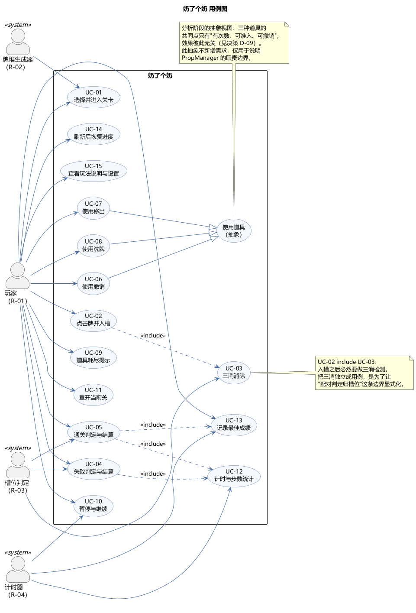

**图 3-1　用例图**：4 个参与者（1 个人 + 3 个系统）、15 个用例，其中 `<<include>>` 关系有四条——UC-02 点击入槽必触发 UC-03 三消检测、UC-04/UC-05 终局必触发 UC-12 计时统计、UC-05 必触发 UC-13 记录。这张图说明了我在需求阶段就定下的两条边界：**判定权归模型**（槽位满不满由 Tray 报、由 Game 下结论）、**结算与记录分离**（结算报事实，记录另存）。

## 3.2 系统分析

### 3.2.1 提示词（P02）

> 第二阶段：系统分析。需求已冻结（见 docs/02-需求分析.md），现在把它翻译成对象模型。本阶段不写代码、不做界面设计。
>
> 【请完成】
> 1. 候选对象识别：从需求中的名词与动词出发，列出候选对象并筛掉"不是对象"的（纯数据、纯动作、界面控件），说明保留与淘汰的理由。
> 2. 核心对象职责：至少覆盖
>    牌 Tile、牌堆 Board（含分层与覆盖关系）、槽位 Tray（含 7 格与三消）、
>    图标库 IconSet / 牌生成器 TileFactory、关卡配置 LevelConfig 与关卡生成 LevelGenerator、
>    游戏流程 Game、游戏状态 GameState、撤销栈 UndoManager / Command、
>    道具 PropManager、计时器 Timer、存档 Repository、视图 Renderer。
>    每个对象给出：职责（做什么）、边界（不做什么）、协作对象。
> 3. 对象关系分析：聚合、组合、依赖、关联，指出多重性与存在理由；
>    重点说明 Tile 与 Board 的关系（Tile 的坐标与层号是否属于 Tile 自身）、Board 与 Tray 的分工。
> 4. 用例实现分析：挑 3 个关键用例（点击一张牌并触发消除 / 撤销一步操作 / 洗牌后重排）说明"玩家→控制器→对象"的协作过程。
> 5. 覆盖判定算法分析：把"一张牌是否可点击"写成不依赖界面的判定过程（几何相交与层号+格位两种思路各说一种，比较取舍）。
> 6. 图示：输出 docs/diagrams/03-用例图.puml 与 docs/diagrams/03-分析类图.puml（PlantUML）。
>
> 【约束】
> - 只做分析，不定类名以外的实现细节（不写方法体、不写数据结构代码）；
> - 若发现需求冲突或遗漏，列成"分析阶段遗留问题"，不要自己改需求；
> - 结尾给一张"分析决策记录"表：决策项 / 备选方案 / 选择理由 / 影响范围。

**我为什么这么问**：这一轮的关键是"**别让它直接写代码**"。AI 的默认倾向是拿到需求就开写，所以我明确写了"不写方法体、不写数据结构代码"，并且要求它给出**淘汰理由**——只写保留了哪些对象是不够的，只有写出"为什么层（Layer）不是对象"，才能看出它有没有真的在做抽象。另外我把"Tile 的坐标属于谁"这个具体疑问直接抛给它，因为这一条决定了后面撤销怎么写。

### 3.2.2 候选对象如何筛选

AI 用了三条准则（C1 有状态、C2 有身份、C3 有独立变化轴），把 34 个候选筛成 14 个核心对象（P06 之后又补了第 15 个 Holding，见 4.2 问题五）。这张表我只保留四类典型，完整版见 `docs/03-系统分析.md` §1.2：

**表 3-4　候选对象的四类去留**

| 类别 | 典型候选 | 判定 | 理由 |
|---|---|---|---|
| 实体（保留） | 牌 Tile、牌堆 Board、槽位 Tray | 保留 | 有身份（同一张牌会在容器间迁移）、有状态、变化原因互不相同 |
| 结构维度（淘汰） | 层 Layer | 淘汰 | 无身份、无独立行为，只是 Board 内的一个索引维度（C2 不满足） |
| 纯动作（淘汰） | 点击、消除、洗牌 | 淘汰 | 没有状态需要记住，落成某对象的方法 |
| 值对象（保留但不做实体） | 最佳记录、设置项 | 降级为纯数据 | 整体替换而非原地修改，不需要身份 |

**表 3-5　15 个对象的职责与落点（14 个核心对象 + 后期新增的 Holding）**

| 对象 | 一句话职责 | 边界（不做什么） | 实现文件 |
|---|---|---|---|
| Tile | 一张牌的身份、图标、层号与格位 | 不判"能不能点"，不管渲染 | `src/model/tile.js` |
| Board | 持有牌集合与**覆盖关系**，回答"这张牌能不能点" | 不做三消、不判胜负、不碰 DOM | `src/model/board.js` |
| Tray | 7 格槽位，报"满不满、有没有三张同图标" | 不判胜负（只报事实），不重排 | `src/model/tray.js` |
| Holding | 移出后的 3 格暂存区 | 不判三消、不压紧（刻意留空位） | `src/model/holding.js` |
| IconSet | 图标池与取用顺序 | 不决定"这一关用几种" | `src/model/icon-set.js` |
| TileFactory | 造 Tile（分配 id、绑定图标与落位） | 不决定牌堆布局 | 由 `LevelGenerator.buildDetailed()` 实现（见注） |
| LevelConfig | 关卡参数与自校验 | 不生成牌 | `src/model/level-config.js` |
| LevelGenerator | 按可解序列反向铺牌，并自检不变量 | 不渲染、不持久化 | `src/engine/level-generator.js` |
| Game | 编排一局的生命周期与一次点击的原子流程 | 不实现判定规则、不碰 DOM | `src/engine/game.js` |
| GameState | 六个状态的合法性判断 | 不存数据 | `src/engine/game.js` 内 |
| Command / UndoManager | 一次可逆操作 + 撤销栈 | 命令只存**值**，不持对象引用 | `src/engine/command.js`、`undo-manager.js` |
| PropManager | 三种道具的剩余次数与准入 | 不实现道具效果 | `src/engine/prop-manager.js` |
| Timer | 累计毫秒与启停 | 不计步数 | `src/engine/timer.js` |
| Repository | 纯数据 ↔ localStorage 的搬运与校验 | 不 `new Tile()`，不认识 Game | `src/data/repository.js` |
| Renderer | 把模型状态渲染成 DOM，转发玩家意图 | 不判定、不改模型 | `src/view/renderer.js` |

（表中把 Command 与 UndoManager 并列算作一个"撤销子系统"；`prop-table.js` 是道具登记表、`slot-strip-view.js` 是槽位与暂存区共用的视图基类，两者都是 P07 走查之后消重复的产物，不另立对象。注：设计阶段把"造牌"画成独立对象 `TileFactory`，实现时发现"分配 id、绑图标、定落位"与"按可解序列反向铺牌"是同一遍循环，于是合并进了 `LevelGenerator.buildDetailed()`，没有单独的 `tile-factory.js` 文件——这是实现期对设计的一个收敛，P10 一致性核对有记录。）

### 3.2.3 两张图的取舍

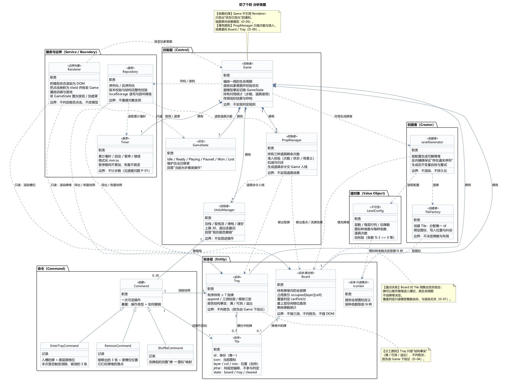

**图 3-2　分析类图**：按"服务与边界 / 控制 / 创建者 / 值对象 / 实体 / 命令"六个包分组，每类只写职责与边界，不写方法。这张图说明了两处刻意取舍：**辅助对象（SoundPlayer、AnimationPlayer）不画进图**（它们只是 Renderer 的内部细节，画进来会把连线搅成毛线团），**不标方法**（分析阶段还没有方法签名）。

用例图（图 3-1）与分析类图的对照关系是：图 3-1 里的 15 个用例，每一个都能在类图里找到"谁来开始、谁来应答"。例如 UC-02 点击入槽，起点是 Renderer 转发意图，执行者是 Game，判定者是 Board（覆盖）与 Tray（容量）。

### 3.2.4 分析阶段发现并遗留的问题

这是我觉得这一轮最有价值的部分——AI 没有硬把冲突圆过去，而是列成 6 条遗留问题交回给我：

| 编号 | 问题 | 后续处理 |
|---|---|---|
| P-01 | "步数"在需求里挂在计时器（R-04）名下，但计时器不该知道步数 | 设计阶段改归 Game 的统计 |
| P-02 | BR-08"洗牌只换图标"与 BR-12"保证可解"冲突：纯随机换图标可能造出死局 | 设计阶段改为"按 group 整组置换"（DD-05） |
| P-03 | 结算里叫"步数"，实际统计的是"入槽次数 + 道具次数" | 结算文案改为"步数（入槽次数）" |
| P-04 | FR-18 说移出后"新建一层"，但 FR-03 又说层数由关卡配置固定 | 先改为"溢出层"，后来整体改为"暂存区"（见 4.2 问题五） |
| P-05 | 需求没列出音效的触发点 | 设计阶段补一张触发点表 |
| P-06 | AC-33 要求验证可解性，但要不要交付一个求解器？ | 交付离线工具 `tools/`，不进运行时 |

同时它给了 11 条分析决策（D-01～D-11），其中三条直接决定了后面的代码形状：

- **D-01 覆盖判定用"层号 + 整数格位"**，不读几何坐标：判定与渲染彻底解耦，抖动、缩放、设备像素比全部免疫。
- **D-02 位置归 Tile 自持，Board 只维护派生索引**：`occupied[layer][cell] === t ⟺ t.state === 'board'`，改位置与改索引只准经 `Board.add/remove`。
- **D-03 撤销用命令模式**，不用全量快照（理由写进了设计阶段的 DD-04）。

### 3.2.5 六条不变量

分析阶段我把"绝不能在任何时刻为假"的断言收敛成 6 条，后面每一轮的实现与自测都绕着它们转：

**表 3-6　项目的六条不变量**

| 编号 | 不变量 | 对应规则 | 破坏后的表现 |
|---|---|---|---|
| I-1 | 占用索引与牌的 state/位置一致 | BR-01 | 牌看着能点却点不动，或已消除的牌仍"压"着别人 |
| I-2 | 每张牌恰好属于牌堆 / 槽位 / 暂存区 / 已消除之一 | 状态机约束 | 牌"消失"或"重复出现" |
| I-3 | 每种图标张数 % 3 == 0（含槽位与暂存区） | BR-04 | 最后剩 1～2 张永远消不掉 |
| I-4 | 槽位长度 ≤ 7 | BR-02 | 槽位溢出仍可继续，失败判定失效 |
| I-5 | 撤销栈长度 ≤ 上限，且只含已成功执行的操作 | BR-06 | 撤销出"幽灵操作" |
| I-6 | 暂停期间累计毫秒不变 | BR-10 | 暂停后时间仍在走 |

> 注：I-3 的"含槽位与暂存区"是测试迭代出来的口径——最初只统计牌堆内，于是正常对局中随时误报（见 4.2 问题二的同源缺陷）。

## 3.3 系统设计

### 3.3.1 提示词（P03）

> 第三阶段：系统设计。对象职责已定（见 docs/03-系统分析.md），现在给出可编码的设计。
>
> 【请完成】
> 1. 总体架构：分层划分——模型层（Tile/Board/Tray/Level/Command）、引擎层（Game 流程、UndoManager、PropManager、Timer、LevelGenerator）、数据层（Repository + localStorage）、表现层（Renderer + 事件绑定）。说明层间依赖方向与禁止反向依赖的具体约束。
> 2. 类设计：给出每个类的属性与关键方法签名（只给签名，不写实现）；重点设计：Tile 的状态机（在牌堆 / 在槽位 / 已消除）与字段；Board 的分层结构（层号 + 位置 + 图标）与覆盖关系怎么算、怎么缓存；Tray 的 7 格模型与三消检测；Command 体系：单步点击命令与道具命令如何统一 undo()；LevelGenerator 如何在生成时就保证"每种图标数量是 3 的倍数"且难度可控。
> 3. 设计模式说明：观察者（状态变更→刷新视图）、命令（撤销）、工厂（牌/关卡生成）、状态（游戏状态机）、策略（关卡生成算法/洗牌算法）——每个模式说明"解决本项目哪个具体问题"，不硬套。
> 4. 数据设计：localStorage 的键与结构、版本字段、默认设置、三个关卡的配置（层数、牌数、图标种类数，牌数必须是 3 的倍数，给出具体数字并验算）、存档裁剪规则（最佳记录保留几条）。
> 5. 关键流程设计：点击消除（含覆盖判定与三消连锁）、撤销（含道具回退）、移出（落点规则）、洗牌（不变量校验）、失败判定（槽位 7 满且无三消可消）——每步写清先做什么后做什么。
> 6. 界面设计：区域划分（顶部状态栏、牌堆区、槽位区、道具区、弹窗层），牌的尺寸与错位偏移、点击热区、层级 z-index 规则、动画（入槽、消除、失败）的触发点。
> 7. 异常与边界设计：牌堆为空、槽位为空时点撤销、道具次数为 0、洗牌后仍无解、窗口尺寸变化。
>
> 【输出】
> - 文件：docs/04-系统设计.md；
> - 图示：docs/diagrams/04-设计类图.puml、04-时序图-点击消除.puml、04-时序图-撤销.puml、04-状态图-游戏状态.puml；
> - 结尾给"设计决策记录"表：决策项 / 备选方案 / 选择理由 / 影响范围（例如：为什么用 DOM 而不是 Canvas、为什么覆盖判定用层号而不是几何相交、为什么撤销要包含道具）。

**我为什么这么问**：我在 P03 里点名了三个具体难题（覆盖关系怎么缓存、命令怎么统一 undo、生成器怎么同时保证 3 的倍数与难度），因为这三处是"能跑"和"改得动"的分水岭。另外我要求它写"禁止反向依赖的具体约束"，因为分层图人人都会画，但"什么样算违规、怎么检测"才是能落地的东西。

### 3.3.2 四层架构与依赖禁令

```
表现层 View      Renderer / BoardView / TrayView / HoldingView / HUD / Dialogs / Effects
                 ↑ 只读快照 + 订阅事件（单向）
引擎层 Engine    Game / GameState / UndoManager / PropManager / Timer / LevelGenerator / PropTable
                 ↑
模型层 Model     Tile / Board / Tray / Holding / IconSet / LevelConfig
数据层 Data      StorageAdapter / Repository / Schema（被引擎调用，不反向依赖）
```

关键不是"分了四层"，而是**每层禁止什么、违反后会怎样、怎么检测**：

**表 3-7　五条依赖禁令**

| 编号 | 禁令 | 违反后果 | 检测手段 |
|---|---|---|---|
| DEP-1 | 模型层不得引用引擎/数据/表现层 | Board 会开始知道"撤销栈"或"DOM"，单测必须造浏览器环境 | `src/model/` 下搜 `from '../engine` 应为 0 命中 |
| DEP-2 | 引擎层不得引用表现层 | Game 直接调 `renderer.refresh()`，"消除后刷新"与"消除逻辑"绑死，改界面就要改规则 | `src/engine/` 下搜 `renderer`/`document` 应为 0 命中 |
| DEP-3 | 表现层不得**写**模型 | 任何界面 bug 都可能改坏局面，撤销栈与真实状态脱节 | 视图只准调 `game.xxx()` 与读 `game.snapshot()` |
| DEP-4 | 数据层不得反向引用引擎层 | Repository 依赖 Game，存档结构跟着流程变 | `src/data/` 下搜 `from '../engine` 应为 0 命中 |
| DEP-5 | 命令对象不得持有 Game 引用 | Game 重建后旧命令失效，且形成环 | 命令只持 tileId 与位置等**值** |

这五条后来在 P07 走查里被验证：DEP-2 确实被违反过一次（`Renderer` 调了 `game.lock()/unlock()`），修法是把"锁多久"交回给 Game（`lockFor(ms)`），见 4.2 问题六。

### 3.3.3 关键设计决策

设计文档最后留了 15 条决策记录（DD-01～DD-15）。这里摘 6 条，都是"当时不这么选就会返工"的：

**表 3-8　六条关键设计决策**

| 编号 | 决策 | 备选 | 选择理由（摘要） | 影响范围 |
|---|---|---|---|---|
| DD-01 | 渲染用 DOM 绝对定位，不用 Canvas | Canvas 2D / WebGL | 原生点击热区与 `aria` 直接可用、CSS 动画免费获得 FLIP、144 个节点对浏览器是小菜、代码量约为 Canvas 的 1/3 | 整个表现层 |
| DD-02 | 覆盖判定用"层号 + 整数格位" | 矩形相交 / 像素级 alpha | 判定与渲染解耦（BR-01 硬要求）、整数比较无浮点误差、O(1) 靠 coverCount、几何法在缩放与动画中会读到瞬时错误值 | Board、Tile |
| DD-03 | 撤销**包含道具**，次数随命令回退 | 只撤销点击 | BR-06 明确"次数归还"；洗牌最容易手滑；把次数做成命令的属性而非独立命令，避免"撤销了效果但次数没还" | 命令全族、PropManager |
| DD-04 | 命令存**最小 delta**，不存整盘快照 | 全量快照 / 操作日志重放 | 快照恢复要重建 Tile，DOM 与动画引用全失效；delta 只动 3～4 张牌；重放对"随机洗牌"不可行 | Command、Board/Tray |
| DD-05 | 洗牌 = 按 `Tile.group` **整组置换**图标 | 完全随机重排 / 只洗可点牌 | 构造性保持可解（BR-12），不依赖概率与重试；完全随机会拆散唯一的三张，让"救急道具"变成"加重惩罚" | ShuffleCommand |
| DD-10 | 数量不变量在**生成期构造**，不做事后调整 | 随机贴后调整 | "每种 % 3"与"可解"同时由构造保证；事后调整要面对"调哪张、会不会破坏可解"的连锁问题 | LevelGenerator |

另有两条与存储有关的：DD-06"存档不保存撤销栈"（刷新后撤销置灰并提示）、DD-08"计时用累计毫秒而不是每秒自增"（浏览器后台节流会让自增模型漂 10 秒以上）。

### 3.3.4 类图、状态图与时序图

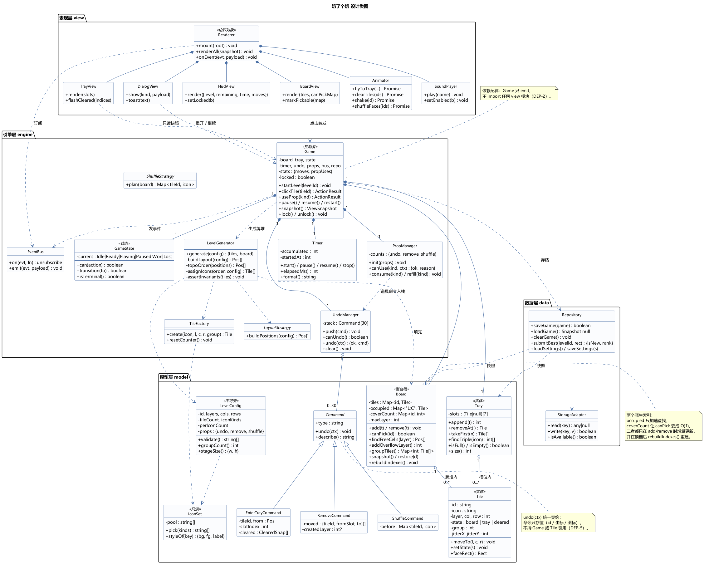

**图 3-3　设计类图**：25 个类按四层分四个包，`EventBus` 单列在左（它是层间唯一的横向通道）。这张图说明了设计阶段与之前的分析类图最大的差别——**方法签名出现了**，而且能看到"谁只读、谁可写"：Renderer 只有 `render/playEnter/playShake` 这类只读方法，而 `Game` 是唯一能同时碰 Board 与 Tray 的编排者。

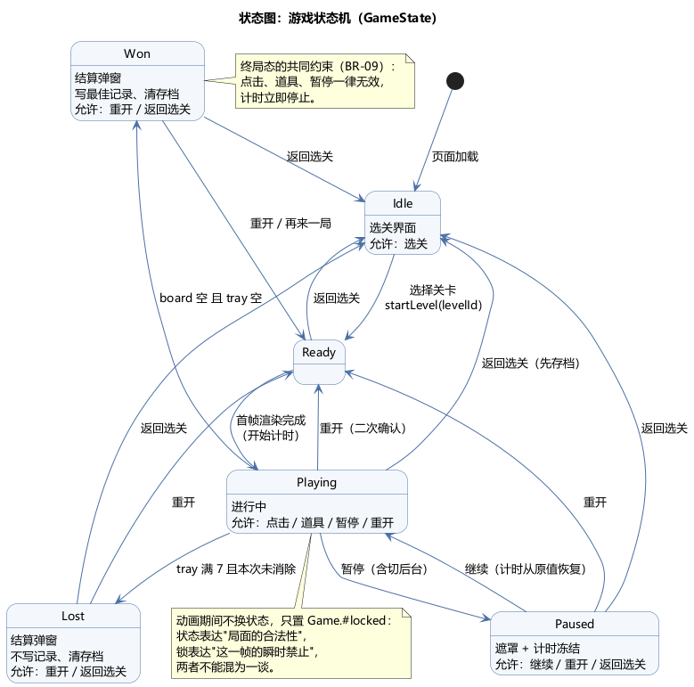

**图 3-4　状态图**：Idle → Ready → Playing ⇄ Paused，Playing → Won/Lost，终局态只允许重开或返回选关。这张图说明了两个刻意的决定：**动画期间不换状态**（只置 `locked` 标志），**终局态锁定一切操作**（BR-09）。前者是因为"动画中途"不是一种合法局面，后者是因为结算弹窗后面还在响应的按钮一定会出 bug。

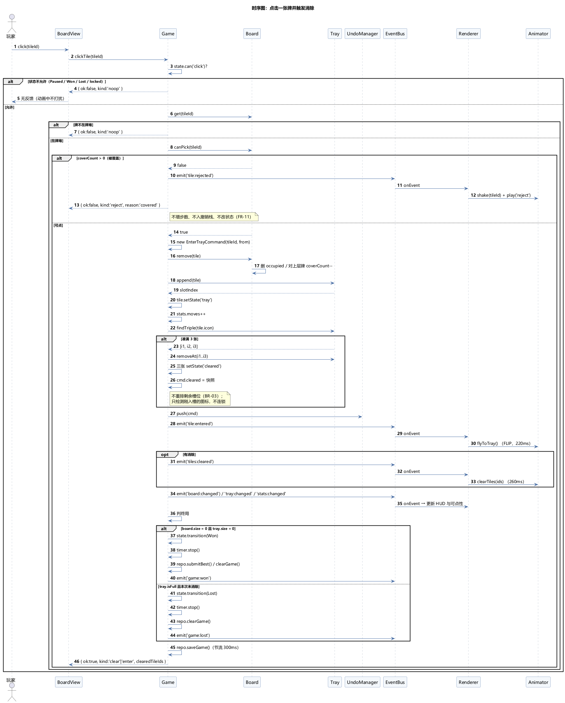

**图 3-5　点击消除时序图**：从 BoardView 转发意图到 Game 判定、Board 摘牌、Tray 入槽、三消检测、事件广播、终局判定，共 46 步。这张图说明了"一次点击是原子操作"是怎么落地的：**所有校验都在动手之前**（状态闸门 → 锁 → 牌在不在 → 能不能点 → 槽位满不满），而唯一的失败点（槽位已满却要入槽）带一次回滚。

**表 3-9　存档字段（14 个，`nailegenai.save`，`v: 1`）**

| 字段 | 含义 | 为什么不存别的 |
|---|---|---|
| v / savedAt / levelId / configHash | 版本、时间、关卡、配置指纹 | 指纹不匹配即判失效（避免改配置后读旧局） |
| status / elapsedMs / moves | 状态、累计毫秒、步数 | 直接恢复，不重算 |
| props / propsInitial | 道具剩余与初始值 | 分开存，否则撤销道具还不回去 |
| tiles / tray / holding / maxLayer / overflowLayers | 牌堆、槽位、暂存区的纯数据 | 不存 DOM、不存撤销栈、不存抖动与可解序列 |

**表 3-10　五个设计模式各自解决的具体问题**

| 模式 | 在本项目解决什么 | 落点 |
|---|---|---|
| 观察者 | 一键刷新：模型改完只发事件，HUD/道具条/牌堆各自订阅，避免"改一处漏三处" | `src/engine/event-bus.js` |
| 命令 | 三类动作 + 三种道具统一 `undo(ctx)`，撤销只认栈顶 | `src/engine/command.js` |
| 工厂 | 牌与关卡都由生成器造，视图只拿结果 | `level-generator.js`（造牌与造关卡已合并） |
| 状态 | 六个状态的合法性判断收敛到 `can(action)`，避免到处写 `if (state !== 'Playing')` | `game.js` 的 GameState |
| 策略 | 洗牌算法与布局算法可替换、可单测 | `level-generator.js` 的 `buildPositions`、洗牌函数 |

## 3.4 AI 迭代开发

### 3.4.1 为什么这样拆

六轮不是按"功能多少"拆的，而是按**"这一轮结束时我自己能不能用眼睛验收"**拆的。开发计划（P04）里有一条硬指标：**每轮结束打开 `index.html` 必须能看到新东西**；超过 800 行的单轮视为切分过粗。

拆轮的价值可以用一个反例说明：**如果把"覆盖判定"和"点击入槽"合成一轮**，那么"点了一张牌没反应"这件事就有至少四种可能——判定写错、入槽被拒、动画没触发、状态没切换。四种可能混在一轮里，我只能靠翻代码猜。而分成两轮之后，第一轮结束时我能在控制台直接调 `board.canPick('t003')` 看到布尔值，第二轮结束时再点，如果没反应，问题必然在"入槽 → 动画"这一段。**把不确定性切成两次，每次只剩一个未知**，这是整个流程里我最受益的一条。

### 3.4.2 六轮总览

**表 3-11　六轮迭代一览**

| 轮次 | 一句话目标 | 覆盖需求 | 交付文件数 | 本轮结束时看到的新东西 |
|---|---|---|---|---|
| 迭代 1 | 页面能开、牌堆能看，但点不动 | FR-02（静态）、FR-03（读取）、FR-06 | 9 | 一叠错位堆叠的牌，控制台打印每层张数 |
| 迭代 2 | 能真正玩到输 | FR-07～FR-13 | 6 | 点牌入槽、凑三消除、槽满判负 |
| 迭代 3 | 三关都能开、都能通 | FR-01/03/04/14/15/21/22 | 7 | 选关界面、三个难度、通关结算、计时步数 |
| 迭代 4 | 三种道具都能用、都能撤 | FR-16～FR-20 | 6 | 道具条、撤销、移出、洗牌 |
| 迭代 5 | 关掉页面也不丢 | FR-05/15/23/24/25/26 | 8 | 刷新续玩、最佳记录、暂停、设置 |
| 迭代 6 | 能拿给别人看 | FR-10（完整动效）、FR-26（音效） | 5 | 飞行与飘字、音效、README、演示脚本 |

**表 3-12　各轮自测断言数的演进（这是我判断"这一轮有没有做扎实"的唯一客观指标）**

| 轮次 | 自测方式 | 断言数 | 首轮通过 | 卡住我的地方 | 记录 |
|---|---|---|---|---|---|
| 迭代 1 | 冒烟脚本 + 无头截图 | 5 条不变量 | 5/5 | 覆盖计数方向写反（见 4.2 问题一） | R-06 |
| 迭代 2 | 引擎级断言页 | 20 | 20/20 | 测试口径写错两处（入槽不减剩余） | R-07 |
| 迭代 3 | 引擎级 + 走完三关 | 53 | 53/53 | 生成器 `order` 是格位不是牌 | R-08、R-09 |
| 迭代 4 | 引擎级 + UI 驱动 | 36 | 36/36 | 撤销"自己凑成三消"那一步 | R-10、R-13 |
| 迭代 5 | 数据层假存储 | 35 | 35/35 | 坏档用例造得太小被配置校验挡下 | R-11、R-12 |
| 迭代 6 | 引擎 + 视图接口 | 30 | 29/30 | 把 `noop` 当成了 `reject` | R-14、R-17、R-22 |
| 后续修复 | 引擎级回归 | 27 + 44 | 27/27、44/44 | P06 布局与 P07 走查各一轮 | R-18、R-19 |

### 3.4.3 迭代 1：骨架、数据模型、静态牌堆（对应交互记录 R-06）

**本轮提示词（摘录）**

> 目标：页面能打开，能看到一个分层错位堆叠的牌堆（用占位图标），但还不能点击。
> 需求：牌堆展示、关卡配置的读取（只读）。
> 交付：index.html、css/main.css、js/model/Tile.js、js/model/Board.js、js/data/levels.js、js/model/Game.js（空壳）、js/view/Renderer.js（只渲染）。
> 约束：Tile 只负责自身数据与状态，不负责渲染；Board 负责分层与位置，负责"牌在屏幕上的坐标"的计算，渲染层只取值；关卡配置写成数据，不允许把层数/牌数写死在渲染代码里。
> 验收：打开页面看到 3 层以上的错位牌堆；牌与牌有重叠；控制台能打印牌堆总张数与每层张数。
> 禁止：点击交互、消除、道具、存档、计时。

**AI 交付内容（关键片段）**

- `Board` 内部三份数据：`_tiles`（id → Tile）、`_occupied`（`layer:col:row` → 牌）、`_coverCount`（id → 压着它的牌数）。
- 覆盖判定的核心两行：`canPick` 只查 `coverCount === 0`，`overlaps` 用整数格位比较：

```js
// src/model/board.js:41
Board.overlaps = function (a, b) {
  return Math.abs(a.col - b.col) < CELL_W && Math.abs(a.row - b.row) < CELL_H;
};
// src/model/board.js:142
Board.prototype.canPick = function (tileId) {
  var t = this._tiles.get(tileId);
  if (!t || t.state !== 'board') return false;
  return (this._coverCount.get(tileId) || 0) === 0;
};
```

**我的试玩结论**：第一轮我给的是"不通过"。牌堆是渲染出来了，但**所有牌都是灰的、能点的牌被压成了暗色**——`pickableIds()` 返回的是第 0 层 15 张，本该是最顶层。界面现象是"整体发灰、层级感对不上"。

**对下一轮的影响**：我先让它查 `assertInvariants()`，I-2 立刻报出 30 条不一致（`t000 期望 0 实际 2`），定位到 `add()` 里把"压着我的牌数"加给了上面那张。修完四处（`add`/`remove`/`rebuildIndexes`/`assertInvariants`）后，第 2 层的 15 张 `coverCount` 全为 0。这件事让我在第二轮提示词里加了一条要求：**"关键判定写成可单独调用的纯方法，便于我用控制台直接验证"**——如果没有 `assertInvariants()` 这个现成的口子，这个方向性的错误会被我带进第二轮，然后在"点不动"时理解成"点击没接上"。

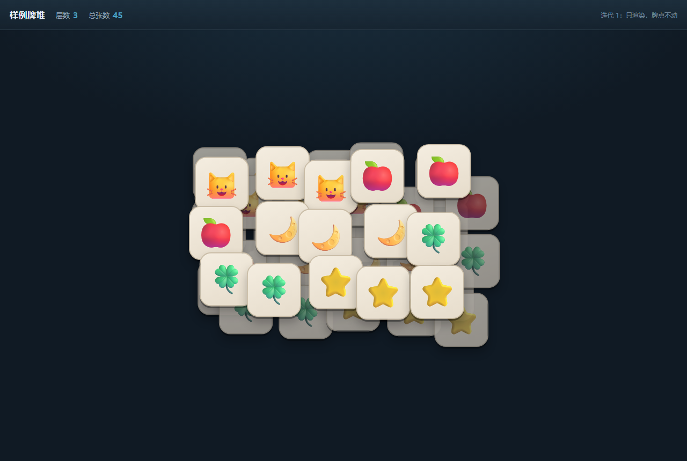

**图 3-6　迭代 1 的静态牌堆**：三层错位堆叠、被压的牌压暗。这张图是"判定与渲染分离"第一次被验证的地方——牌的亮暗只由 `coverCount` 决定，跟它在屏幕上的坐标没有任何关系。

### 3.4.4 迭代 2：交互核心（点击 → 入槽 → 三消 → 失败）（对应交互记录 R-07）

**本轮提示词（摘录）**

> 目标：能真正玩起来——点可点的牌、进槽、凑三消除、槽满判负。
> 约束：覆盖判定必须放在 Board 上，返回布尔值，不得掺入任何 DOM 判断；Tray 只负责槽位与三消，不负责计分与界面；失败判定必须由"槽位满 7 且本次入槽后不产生三消"推导，不能写成"点了 7 次就输"；一次点击的状态变更是原子操作：要么全部生效，要么完全不变。
> 验收：能完整玩到失败；能验证"被压住的牌点不动"；槽位中同图标 3 张立即消失；控制台可手工调用判定函数验证边界。

**AI 交付内容（关键片段）**

`Game.clickTile` 的五道前置全部在动手之前，唯一的可失败分支带回滚：

```js
// src/engine/game.js（迭代 2 版本）
if (!this.can('click')) return reject('state:' + this._state);
if (this._locked) return reject('locked');
var tile = this._board.get(tileId);
if (!tile) return noop('missing');
if (!this._board.canPick(tileId)) return reject('covered');
if (this._tray.isFull()) return reject('tray-full');
// 到这里才动手：移除 → 入槽 → 计步 → 三消 → 终局 → 压命令
```

三消检测只查"刚入槽的那个图标"，不查全部——这一条把"三消连锁"这个容易写错的东西直接排除了：

```js
// src/model/tray.js:71
var hits = [];
for (var i = 0; i < this._capacity; i++) {
  var t = this._slots[i];
  if (t && t.icon === icon) {
    hits.push(i);
    if (hits.length === 3) return hits;
  }
}
return [];
```

**我的试玩结论**：这轮是"有条件通过"。20 项断言全过，但试玩时我立刻发现一个尴尬的现象：**点一下牌，顶部"剩余"数字不动**。我一开始以为是 bug，后来发现是我自己的测试口径写错了——"剩余 = 牌堆未消除 + 槽位中牌数"，入槽只是把牌从一个容器搬到另一个容器，只有三消才减 3。这条口径是 Q-04 裁决时写进 FR-02 的，测试时我自己忘了。

**对下一轮的影响**：这轮之后我要求每轮交付时必须给"**3～5 步手工验证指引**"，而不是只说"已实现"。因为断言能证明模型对，但证明不了"我作为玩家能看懂界面在说什么"。

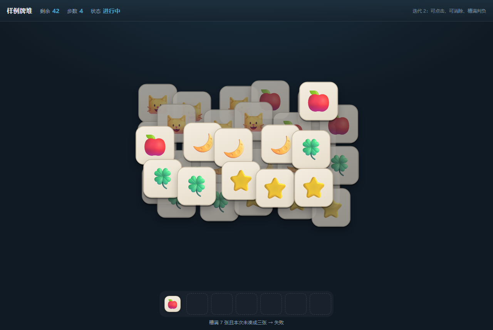

**图 3-7　迭代 2 的三消后状态**：槽位里剩一张苹果，顶部"剩余 42 / 步数 4"。这张图说明了"步数"与"剩余"是两个不同的量：一次点击让步数 +1，但只有消除才让剩余 −3。

### 3.4.5 迭代 3：关卡与生成器（三关 + 通关 + 计时步数）（对应交互记录 R-08、R-09）

**本轮提示词（摘录）**

> 目标：三个难度都能开、都能通关，牌数正确，牌堆清空即通关。
> 约束：LevelGenerator 必须在生成后自检"每种图标张数 % 3 === 0"，不满足就重生成，并把自检结果写进注释；关卡配置只写"层数、每层布局、图标种类数、总牌数"，具体哪张牌是什么图标由生成器决定；计时器暂停时停止累加，恢复时继续，不允许出现"暂停后时间跳一下"；生成算法要保证不会出现死局（生成时按三张一组投放到同一可解序列，说明你的做法）。

**AI 交付内容（关键片段）**

生成器先算出一条"合法拆除序列"，再沿序列每 3 张一组发同一图标——这样"可解"是被构造出来的，而不是被试出来的：

```js
// src/engine/level-generator.js 自检（节选）
function selfCheck(tiles, config) {
  var errors = [];
  var perIcon = Object.create(null);
  tiles.forEach(function (t) { perIcon[t.icon] = (perIcon[t.icon] || 0) + 1; });
  Object.keys(perIcon).forEach(function (icon) {
    var n = perIcon[icon];
    if (n % 3 !== 0) errors.push('图标 ' + icon + ' 有 ' + n + ' 张，不是 3 的倍数');
    if (n !== config.perIconCount) errors.push('图标 ' + icon + ' 有 ' + n + ' 张，配置要求 ' + config.perIconCount + ' 张');
  });
  ...
}
```

**我的试玩结论**：通过。53 项断言全绿，三关数字 60 / 108 / 144 正确，关卡生成"首次尝试即可解"（槽位峰值始终为 3）。但试玩时我提了一个界面意见：**牌太大、太密**——每张牌约 100 px，同层相邻牌严丝合缝贴死。这句意见后来引出 4.3 节那次"布局返工"，也说明"能玩"和"看着舒服"是两件事。

**对下一轮的影响**：这轮第一次跑完整通关（60 步），跑完后我发现撤销功能必须先做——因为一旦打错一步整局就废了，而验证"打错"的成本太高。

### 3.4.6 迭代 4：道具（撤销 / 移出 / 洗牌）（对应交互记录 R-10、R-13）

**本轮提示词（摘录）**

> 约束：每一次会改变状态的玩家动作都要生成命令对象，入栈；撤销 = 栈顶命令 undo()；道具使用本身也是一条命令（撤销道具 = 归还次数 + 恢复牌面）；移出：把槽位中前 3 张牌按原图标放回牌堆最上层，位置规则见设计文档，放回后仍可点击；洗牌：只重排牌堆中未消除牌的图标，位置与覆盖关系不变，洗牌后必须重新自检不变量；撤销栈上限与道具次数上限都写在配置里，不允许散落在代码中。
> 验收：连续点 10 次后连撤 10 次能回到开局牌面；用掉一次移出后撤销，移出次数恢复且槽位恢复；洗牌 20 次后不变量仍成立。

**AI 交付内容（关键片段）**

命令只存值不存对象（DEP-5），撤销时靠 id 复活或复用实例：

```js
// src/engine/command.js:EnterTrayCommand.undo
EnterTrayCommand.prototype.undo = function (ctx) {
  var slot = ctx.tray.indexOf(this.tile.id);
  var entered = slot >= 0 ? ctx.tray.removeAt(slot) : null;
  Command.restoreSlots(ctx, this.trayBefore, []);
  var back = entered || ctx.revive(this.tile);
  if (this.source === 'holding') { ctx.holding.clear(); Command.restoreHolding(ctx, this.holdingBefore, [back]); }
  else { back.setState('board'); ctx.board.add(back); }
  ctx.stats.moves -= 1;
  return { ok: true };
};
```

**我的试玩结论**：这一轮我抓到两个真 bug。第一个是撤销"自己凑成三消的那一步"必失败——因为那张牌已经被消掉了，`undo` 却还去槽里找它，抛出 `EnterTrayCommand.undo: t004 不在槽中`，而且失败的命令被压回栈顶，导致后面每一次撤销都撞同一张。第二个是不变量自检误报（I-3 只统计牌堆内的图标）。

**对下一轮的影响**：这两处让我在第五轮之前把 `assertInvariants` 从"牌堆自检"提升成"整局自检"（把槽位、暂存区的图标数一起算），并要求"撤销必须能撤销任何一次成功操作"写进验收。

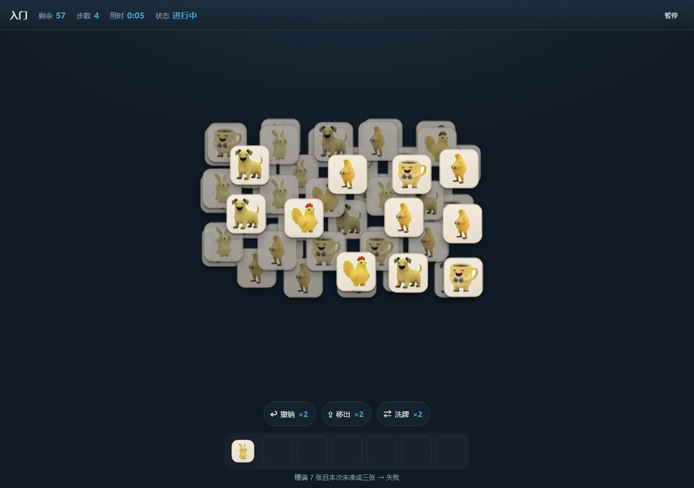

**图 3-8　撤销后的状态**：撤销把槽位里的那张牌放回牌堆原位，同时"撤销 ×3→×2、移出 ×2→×3"（撤销了上一步的移出）。这张图说明了 DD-03 那条决策的可见效果——**道具次数是命令的一部分**，所以撤销能把它一起还回去。

### 3.4.7 迭代 5：持久化与设置（对应交互记录 R-11、R-12）

**本轮提示词（摘录）**

> 目标：刷新不丢进度，记录能留存，设置能开关。
> 约束：存档只存"可重建状态的最小集合"，不存 DOM、不存函数、不存类实例（存普通对象，读出后重建实例）；存档带版本号，读档时校验版本，不匹配则按默认值处理并提示；最佳记录按关卡分别保存（最短通关时间、最少步数），只保留更优值；重开必须二次确认，且不影响最佳记录。
> 验收：玩到一半刷新，牌面/槽位/计时/步数/道具次数全部恢复；打破记录后刷新仍显示新记录；重开后回到该关初始状态。

**AI 交付内容（关键片段）**

`Game.restore(data)` 只做"按数据重建对象"，一行旧逻辑都没改（符合"禁止改前四轮模型逻辑"）：

```js
// src/engine/game.js:restore（节选）
this._board.clear(); this._tray.clear(); this._holding.clear();
data.tiles.forEach(function (d) { /* new SM.Tile(...) 按 state 分派 */ });
this._props = new SM.PropManager(data.props, data.propsInitial);  // 当前值与初始值分开
this._undoStack = new SM.UndoManager(config.undoStackLimit);      // 撤销栈刻意清空
this._timer.reset(); this._timer.setElapsed(data.elapsedMs);
```

**我的试玩结论**：通过，35 项断言全绿（其中 11 条是"存档只存最小集"的检查：不含 DOM、不含函数、体积 < 64 KB）。真机验证方式是用固定的浏览器用户目录跑两次——第一次点 5 下并保存，第二次重新加载，弹出"继续上局？（关卡：入门 / 已用 0:05 / 步数 5 / 剩余 57 张）"。

**对下一轮的影响**：`configHash` 的字段选择在这一轮定下来（不含道具次数），理由是"微调难度不该让在玩的那局作废"。这个决定后来在 P06 改关卡参数时救了我一次——虽然因为改了 `iconKinds` 还是失效了，但至少失效原因是可解释的。

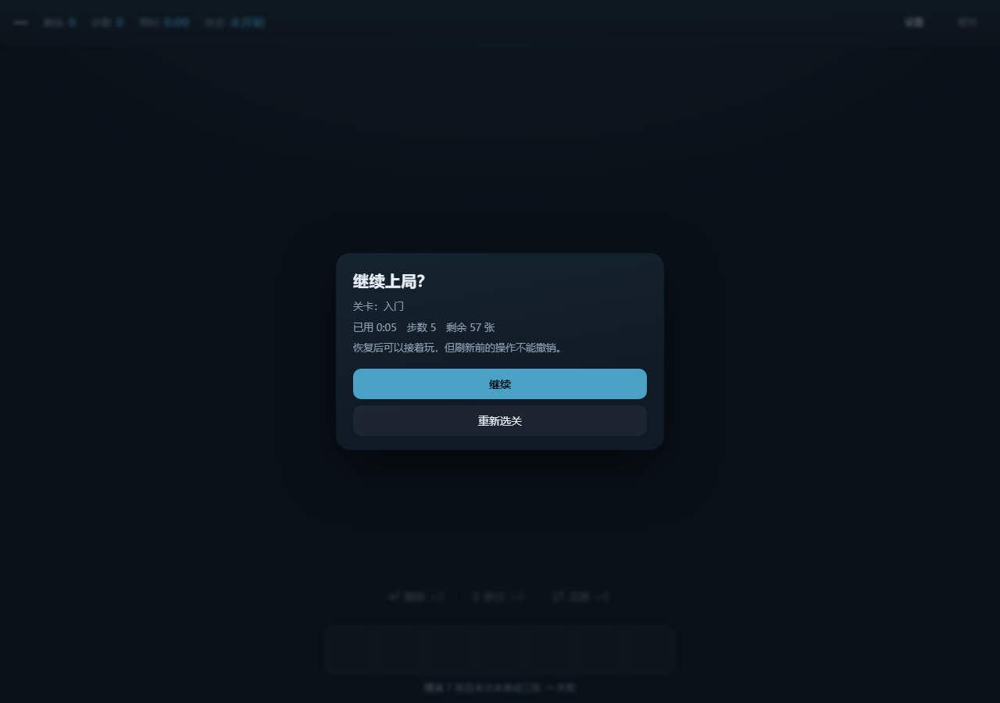

**图 3-9　刷新后的"继续上局"**：显示关卡、已用时间、步数与剩余牌数，并提示"恢复后可以接着玩，但刷新前的操作不能撤销"。这张图说明了 DD-06 的取舍被如实告知玩家，而不是静默失效。

### 3.4.8 迭代 6：打磨与交付（对应交互记录 R-14、R-17、R-22）

**本轮提示词（摘录）**

> 目标：能拿去演示——动画顺滑、有反馈、有说明。
> 约束：动画不得改变游戏状态，只影响表现；动画期间重复点击必须被忽略（防连点）；音效用 WebAudio 合成，不引入音频文件；开关状态存存档；README 写清：怎么运行、玩法、三关难度、道具说明、已知限制；演示脚本按"开局 → 点击消除 → 用移出 → 撤销 → 洗牌 → 通关/失败"的顺序写，每步一句话。
> 验收：三关各完整玩一遍不崩；连续快速点击不出现重复入槽；按 README 的步骤能重现演示流程。

**AI 交付内容（关键片段）**

音效全部用振荡器与噪声合成，不引入任何音频文件（呼应 NFR-01"无网络请求"）：

```js
// src/audio/sound.js（节选）：clear 音 = 三个短音
ctx.play('clear') → 784 Hz / 988 Hz / 1319 Hz，各 60 ms 三角波
ctx.play('shuffle') → 白噪声 + bandpass 扫频 700→2600→900 Hz，620 ms（与动画同长）
```

**我的试玩结论**：通过，30 项断言（含"连点 12 次只有 1 次入槽"）。但我明确记了一条待办：**截图是脚本把动画定格在 320 ms 拍的**，报告里必须注明，否则读者会以为动画只有一帧。

**对下一轮的影响**：这一轮交付后程序已经"能拿出去演示"，于是进入 P06/P07 的修复与走查。后面三次改动（暂存区、布局散铺、走查修复）虽然是计划外的，但都建立在六轮之上，没有推翻任何已验收模块。

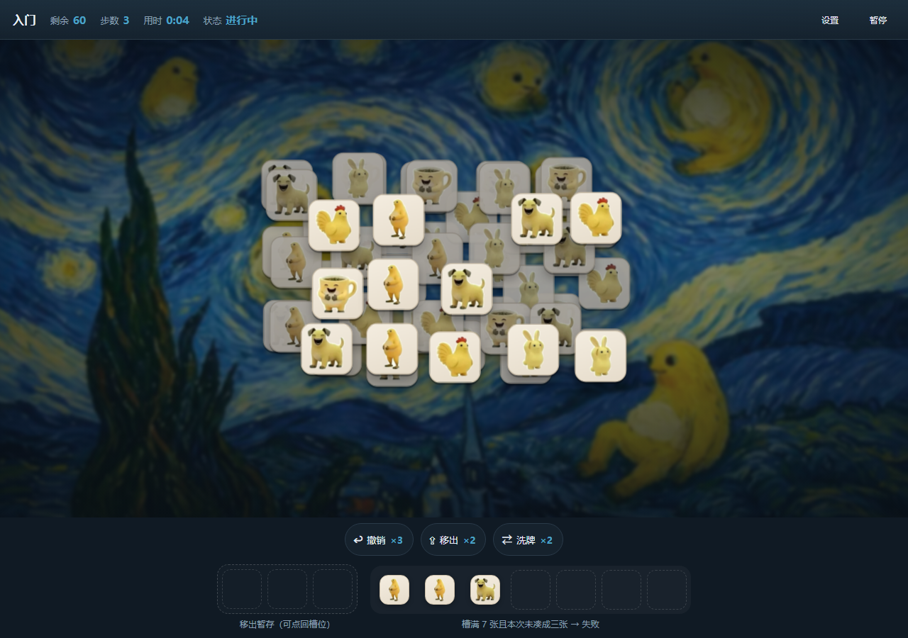

**图 3-10　迭代 6 之后的成品界面**：背景是《星月夜》风格的重绘，做了 `blur(2px)` + 压暗 + 暗角处理，只铺牌堆区。这张图说明了"素材全部本地化、双击即跑"这条非功能需求是怎么被满足的——三张图（图标 16 张、背景 1 张）全部是本地 PNG。

## 3.5 面向对象机制在项目中的落点

### 3.5.1 封装：状态只能经方法变更

`Tile` 的 `state` 只允许 `board / tray / holding / cleared` 四值，且只能经 `setState()` 改；`icon` 一度是公开字段，被 P07 走查定性为"必须改"，于是加了 `setIcon()` 并在三处赋值点全部改调它。理由很实在：`icon` 是三消判据与 I-3 的统计维度，写坏了**不会报错**，只会表现为"这个图标永远凑不齐"。

封装的收益在撤销上体现得最明显：`EnterTrayCommand.undo` 不需要知道槽位的内部数组长什么样，它只调 `indexOf / removeAt / append`，所以当槽位从"紧凑数组"改成"定长带洞数组"（DD-14）时，命令一行没改。

### 3.5.2 命令：一切可撤销动作统一 undo

四类动作（入槽、移出、洗牌、撤销道具效果）都是 `Command` 的子类，都实现 `undo(ctx)`，`UndoManager` 只认栈顶。`ctx` 是 Game 造出来的"能力包"（`{board, tray, holding, props, stats, revive}`），命令**不认识 Game**——这条 DEP-5 让命令可以在测试里手工构造上下文执行，不需要起一个完整游戏。

代价也很清楚：因为命令只存值，撤销"消除"时必须能"复活"一张牌（`ctx.revive(data)`），于是 `Tile` 的抖动值必须能由 id 稳定推出（哈希函数），否则撤销后那张牌的视觉位置会跟原来不同。

### 3.5.3 组合与聚合：牌在两个容器间迁移

`Board` 对 `Tile` 是**聚合**（牌可以离开牌堆进槽位，生命周期不随牌堆结束），`Tray` 对 `Tile` 也是聚合，而 `Board` 内的 `_occupied` 索引是**组合**（随 Board 存亡）。这个区分不是学术练习：正因为是聚合，撤销才能"把牌放回牌堆"而不需要重建对象；也正因为索引是组合，`Board.remove()` 必须同步更新 `coverCount`，否则会出现"牌已经走了，别的牌还被它压着"。

### 3.5.4 工厂与策略：把"变化"关进两个函数

- 工厂：`LevelGenerator.buildDetailed()` 负责造牌（分配 id、绑图标、定落位）并按可解序列反向铺成整局。设计阶段把"造牌"与"造关卡"画成两个对象（`TileFactory` / `LevelGenerator`），实现时发现两者是同一遍循环，于是合并——视图只拿结果，不知道牌是怎么来的。
- 策略：`buildPositions`（布局算法）与洗牌函数各自独立，可以单独测试。P06 把布局从"每层铺满"改成"随机取样 + 塔形收拢"时，只动了 `buildPositions` 一个函数，`peelOrder`、`buildCovers`、`selfCheck` 全部原样复用。

## 3.6 本章小结：AI 协作经验

这十条提示词跑下来，我觉得有效的做法就四条：

1. **先约束，再要结果。** P00 的最大价值不是它给了什么，而是它被禁止给什么。一开始就写明"这一轮不许写代码"的收益，是后面每一轮都不会收到 500 行我读不完的代码。
2. **把验收条件写成可执行动作。** "操作流畅"没法验收，"连点 12 次只有 1 次入槽"可以。所以我几乎每条提示词的最后都有一句"控制台能手工调用 ×× 验证"。
3. **一次只推进一层。** 六轮的划分标准不是功能多少，而是"这一轮结束后我能不能用眼睛判断对错"。这也是 3.4.1 那个反例的意义。
4. **要根因，不要补丁。** P06 的提示词模板里我固定写了"先定位根因，不要直接给补丁""判断是实现错误还是设计缺陷"。第 4 章里六个问题的修复质量差距，基本就取决于这一条有没有被遵守。

---

# 第 4 章 人工测试过程

## 4.1 测试方法

我的测试分三层，每层解决不同的问题：

**表 4-1　三层测试的分工**

| 层级 | 做法 | 能发现什么 | 发现不了什么 |
|---|---|---|---|
| 模型/引擎级断言 | 无头浏览器加载真实脚本，用 `<pre>` 输出 PASS/FAIL | 判定错、不变量破、撤销不对称、存档往返不一致 | 界面看不清、动画卡顿、点击热区不对 |
| 界面驱动级 | 注入脚本模拟点击，回读 `document.title` 与 DOM 节点数 | 事件没接上、道具条文案错、槽位与模型不同步 | "看着是否舒服" |
| 人工试玩 | 我自己按演示脚本玩一遍，截图比对 | 视觉层级、动效观感、文案误导 | 低频边界（要靠第一层兜） |

之所以把第一层做成"无头浏览器 + 断言页"，是因为纯手工点只能覆盖主流程。真正让这个项目站住的是第一层：迭代 2～6 一共查出 6 处真缺陷，其中 4 处（覆盖计数方向、撤销被消掉的牌、不变量误报、坏档未拦截）**在纯手工点上根本发现不了**，它们只在"连点 10 次再连撤 10 次""洗牌 20 次""塞一个坏存档"这类破坏性动作下才暴露。

第二层专门治"模型对了但界面没跟上"。第三层治"技术上都对但看着难受"——第 4.2 节的 P-2、P-3、P-4、P-6 都是第三层发现的。

**表 4-2　AC-01～AC-34 逐条验证结果**

| AC | 验证内容（摘要） | 结果 | 备注 |
|---|---|---|---|
| AC-01 | 入门关看到四层错位牌堆，被压的牌更暗 | 通过 | 图 1-2 |
| AC-02 | 三关都能进入 | 通过 | |
| AC-03 | 三关总张数 60/108/144 | 通过 | 断言页逐关打印 |
| AC-04 | 控制台自检不变量返回 true | 通过 | `game.assertInvariants()` |
| AC-05 | 同层牌有随机偏移、无完全重合 | 通过 | 抖动 ±9 px（牌宽的 1/6） |
| AC-06 | 点被压住的牌：不移动、只有抖动 | 通过 | `reject/covered` |
| AC-07 | 点顶层牌：飞入槽位、下方牌变亮 | 通过 | |
| AC-08 | 连点三张不同图标，槽位从左到右排列 | 通过 | |
| AC-09/AC-10 | 三张同图标立即消除 | 通过 | 图 3-7 |
| AC-11 | 消除动画期间连点被忽略 | 通过 | 连点 12 次只入槽 1 次 |
| AC-12 | 连点被压住的牌 3 次，步数不变 | 通过 | |
| AC-13 | 槽位满 7 且无消除 → 失败 | 通过 | |
| AC-14 | 第 7 张恰好凑三消时不判负 | 通过 | 断言页专测 |
| AC-15 | 清空牌堆 → 通关 | 通过 | 按拆除序列走完 60 步 |
| AC-16/AC-17 | 结算弹窗内容与按钮 | 通过 | 图 1-5 |
| AC-18 | 道具栏图标、名称、次数 | 通过 | 图 1-4 |
| AC-19/AC-20 | 撤销回原位、次数减、为 0 时置灰 | 通过 | 图 3-8 |
| AC-21 | 移出后那几张立即可点 | 通过 | 改为暂存区后仍满足 |
| AC-22 | 洗牌不动位置、只换图标 | 通过 | 断言页对比前后坐标 |
| AC-23 | 移出 + 洗牌后连撤两次，三处都复原 | 通过 | |
| AC-24 | 用到 0 次后按钮置灰、其他道具不受影响 | 通过 | |
| AC-25/AC-26 | 计时递增、步数只算成功入槽 | 通过 | |
| AC-27 | 暂停 10 秒不跳变，继续后接着走 | 通过 | 图 3-4 的状态约束 |
| AC-28 | 玩到一半刷新全部恢复 | 通过 | 图 3-9 |
| AC-29 | 更差成绩不覆盖最佳记录 | 通过 | 图 1-1 |
| AC-30 | 关闭音效后刷新仍记得 | 通过 | `nailegenai.settings` |
| AC-31 | 首屏 <1.5 s、点击反馈 <100 ms、无网络请求 | **部分通过** | 无网络请求与控制台无报错已确认；首屏与反馈未做毫秒级仪器化测量 |
| AC-32 | 挑战关连玩 3 轮无卡顿、无内存异常 | **部分通过** | 连玩 3 轮未崩、无报错；内存未做采样对比 |
| AC-33 | 三关都存在可清空的点击序列 | 通过 | 生成器按拆除序列走完即证明存在（60/108/144 步） |
| AC-34 | HUD 剩余牌数只在消除时 −3 | 通过 | 图 3-7 |

统计：34 条中 **32 条通过、2 条部分通过（AC-31、AC-32）、0 条不通过**。两条部分通过的原因是我没有做性能仪器化测量，只有目测与"无报错"证据——这一点在 4.3 里如实列为遗留。

## 4.2 典型问题

以下六个问题都保留了我当时的判断过程，包括我判断错的地方。每个都能在 `docs/07-AI交互记录.md` 里对上一条 R-xx 记录。

### 问题一：所有牌都"发灰"，能点的牌被压成了暗色（R-06，我自查发现）

**现象**：迭代 1 的页面出来了，牌堆是渲染出来了，但**每张牌都是灰的**，`is-covered` 这个类加在了最顶层的牌上。我点不动任何牌——当时我还以为"点不动"是因为这一轮本来就禁止点击。

**我的判断与提示词**：这一轮没有用户报障，是我自己按"3～5 步手工验证"跑控制台时发现的：`SM.app.board.pickableIds()` 返回的是第 0 层 15 张，而本该是最顶层 15 张。于是我把问题压缩成一句可以验证的话交给 AI：**"`pickableIds()` 返回的是最底层而不是最顶层，并且 I-2 报了 30 条不一致（例如 t000 期望 0 实际 2），请定位根因。"**

**AI 给的根因**：属**实现错误**，而且在同一处写错了两遍。`Board.add` 里写的是"如果新牌在上方，就给**上方那张** +1"——语义反了。`_coverCount[X]` 的含义应该是"压在我上面的牌数"，所以应该是"上方那张不被压、给下面的 +1"。

**修复与复测**：要同时改四处（`add`、`remove`、`rebuildIndexes`、`assertInvariants`），否则增量维护与自检会互相"证明"对方是对的。改完 `layer 2` 的 15 张 `coverCount` 全为 0，五条不变量全绿，截图确认顶层明亮、下层压暗。

### 问题二：飞行中的牌永远是"小猫"（R-07，用户报障）

**现象**：用户原话：**"点那个牌不管是什么进那个框的时候都是小猫的牌"**，随后补充"有一瞬间是小猫的牌"。

**我的判断与提示词**：这句"有一瞬间"非常关键——它把范围从"入槽逻辑"缩小到"飞行动画的 220 毫秒"。我据此写提示词：**"只有飞行那一瞬间图标错，落地后槽位里的图标是对的，说明模型没错，是飞行层取图标取错了，请查飞行层是怎么取图标的。"**

**AI 给的根因**：属**实现错误**。飞行层用 `this._stage.querySelector('.tile[data-id]')` 取图标——**选择器没有限定 id**，取到的是舞台上剩下的第一张牌（样例牌堆里 `t000` 恰好是猫）；而 `playEnter` 会先重渲染牌堆把源节点删掉，于是"飞的永远是最先渲染的那张"。落地后图标来自模型，所以只有飞行期间是错的。

**修复与复测**：改成图标由模型经参数传入（`game.iconSet.glyph(result.icon)`），删掉那个选择器。回归用例特意挑了一张**非猫**的牌，断言"飞行层图标 === 被点牌的图标"。顺带排查了同类隐患：另外三处 `querySelector` 都带 `[data-id="..."]`。

### 问题三：槽位里的牌消除后不往前补（R-09，用户报障）

**现象**：用户原话：**"图二有一个bug就是前面的卡片消掉后，下面栏的卡片不会自动到最前面几个"**。

**我的判断与提示词**：这条表面看是渲染问题，但我知道槽位模型是"定长 7 格、允许有洞"（DD-14），洞是模型层的语义。所以我写的是：**"槽位消除后留了洞，用户期望剩下的牌往前补。请判断：是模型该压缩，还是视图该压缩？两者对撤销各有什么影响？"**

**AI 给的根因**：属**设计缺陷**，不是实现错误——原始 BR-03 写的是"消除后不重排"，这条规则本身就跟用户预期相反。它给了两个方案：视图层压缩（模型仍留洞）会与撤销的"放回原槽号"冲突；模型层压缩则需要撤销记"压缩前的位置"。

**修复与复测**：选模型层压缩（`Tray.compact()`），命令改成记"槽号序列"而不是"第几张牌"，视图侧给牌加 `left` 过渡，让压缩看起来是"滑过去"而不是"跳一下"。改完 9 项断言通过（含 `--slot-i` 与 `tray.indexOf(id)` 全一致）。这件事的教训写进了报告：**规则与用户直觉冲突时，先怀疑规则**。

### 问题四：洗牌动画"不像在打乱"（R-12，用户报障）

**现象**：用户原话：**"洗牌加一个全部牌打乱的一个动画，感觉这个动效不像牌打乱的"**。

**我的判断与提示词**：我先自己看了一遍旧实现（整堆 `rotate` ±7°、280 ms，而且图标在动画开始前就换好了），把问题拆成三条可操作的判断：①动作幅度不够（7° 看起来像"抖一下"）；②所有牌同时同向动，没有"被抄起来搅乱"的感觉；③**图标在动画开始前就变了**，玩家看到的是"新牌在原地抖"，当然不像打乱。于是提示词里我直接给了这三条。

**AI 给的根因**：属**实现错误**（表现层的编排问题）。修法是把动画改成三段式：先"抄起来"（向牌堆中心收拢 90%、随机旋转 ±34°、错峰 14 ms），在 46% 处换图标，再"落回去"。

**修复与复测**：调参花了三轮——0.62/±23° 仍像"整体收了一下"，0.78/±34° 有起色，0.90/±40 px 才像被搅乱。复测除了看截图，还检查了收尾：`locked=false`、残留动画节点 0、撤销栈 +1、不变量仍成立。

### 问题五："移出"不是移回牌堆（R-13，用户报障）

**现象**：用户原话：**"另外移出不是移到牌堆里，是单独拿出来"**。

**我的判断与提示词**：这条是**语义变更**，不是 bug。关键风险我先自己推了一遍：如果牌被拿走后不能回槽位，那么每用一次移出就永久少 3 张牌，I-3（每种图标张数 % 3）当场破掉，直接死局。所以提示词里我先写死了一条约束：**"这几张牌必须仍然点得回槽位，否则不变量会破、直接死局。"**

**AI 给的根因**：属**需求缺陷**（BR-07 的落点规则与用户心智模型不符）。它提出用一个 3 格 `Holding` 暂存区替代"溢出层"，并列出四处连带改动：通关判据要加"暂存区为空"、命令要记 `source: 'board' | 'holding'`、存档要加 `holding` 字段、视图要新增一块。

**修复与复测**：新增 `src/model/holding.js`，`clickTile` 增加"从暂存区点回"的分支，`_removeThree` 改为"取前 3 张进暂存区"。74 项断言（含撤销点回、撤销移出、暂存满拒绝、存档往返）。复测时发现一个真 bug：`Tile.setState('holding')` 抛"非法状态"——状态表里没有 `holding` 这一项。

### 问题六：越玩越挤，牌全挤到中间（R-18，用户报障）

**现象**：用户原话：**"玩到后面卡片自动会居中，卡片种类不够丰富，卡片太挤了感觉全在中间"**。

**我的判断与提示词**：我给了一条带五步流程的提示词（定位根因 / 判断是实现错误还是设计缺陷 / 最小改动 / 改完说清改了哪几行 / 不要顺手改无关代码），因为这三个症状很可能是**三个不同的原因**。

**AI 给的根因**：两个原因，性质不同：

- **居中与缩放属实现错误**：`BoardView.render` 用"剩余牌的边界"算舞台尺寸，每消掉最右一列牌盒子就缩一圈，舞台居中导致剩余牌整体往中间漂；同时 `fit()` 的比例 `k` 因为盒子变小而顶到上限，牌被放大。两者叠加就是"越玩越挤"。
- **图标种类少属设计缺陷**：`docs/04` §5.3 把图标种类写死成 5/6/8 种，挑战关又用 9 层 ×4×4 的窄格子——层级多但横向太窄，视觉上必然挤。

**修复与复测**：`render(board, config)` 改用**关卡配置**算舞台尺寸（固定不变），`fit` 上限回调；三关图标种类改为 10/12/16、挑战关改为 6 层 ×6×4。验证方法是"漂移探针"：挑战关点 0 下与点 22 下各测一次舞台矩形，两次都是 `743×531`、牌宽 71 px，改前会逐次缩小。

### 一段被否决的改动：R-15/R-16

这一对记录我留在报告里，因为它比"改对了"更有价值。

我看到"牌面乱"之后，判断是"信息太多"，于是做了三件事：被压住的牌**不画图案**、牌面简化、抖动归零。用户的第一次否决是：**"取消第一条"**——因为看不见的牌等于让玩家猜。我改成"保留图案 + 半透明"，用户第二次否决：**"这个完全不对，太规整了，一个一个排的好好的，回退改之前的"**。

我复盘后明白了两件事：**第一次是信息问题**（不能藏图案），**第二次是手感问题**（抖动是"这些牌是被人摆上去的"这条信息，不是装饰）。而第二版之所以更糟，是因为我把每张牌裁成同样大小、同样间距，**规整度反而又提高了一级**。这次整体回退（抖动恢复 ±9 px、牌面恢复双层描边）之后，我才在 P06 里从"布局算法"而不是"牌面样式"入手解决问题——方向对了，效果立刻不一样。


**图 4-1　被否决版本的问题现场**：这张图是"被压住的牌不画图案"那一版的截图。牌堆变成了深色方块阵列，玩家无法判断"哪张是哪张"，但确实"不乱了"——这正是我当时判断错误的证据，所以我把这张图留在报告里。

## 4.3 测试结论

**通过率**：34 条验收中 32 条通过、2 条部分通过（性能两项未仪器化）。引擎级断言累计 **250 条**（5+20+53+36+35+30+27+44，各轮数字见表 3-12），最终两轮（迭代 6 的 30 条与 P07 走查后的 44 条）全绿。

**遗留问题与影响**：

| 编号 | 遗留 | 影响 | 是否阻塞提交 |
|---|---|---|---|
| L-1 | 性能未做毫秒级仪器化测量 | AC-31/AC-32 只有主观证据 | 不阻塞，但报告里必须写明 |
| L-2 | 移动端未适配 | 手机上布局换行、热区偏小 | 需求已明确排除，不阻塞 |
| L-3 | 关卡可解性是构造性保证，无运行时求解器 | 玩家仍可能找不到解法 | 设计取舍（DD-11），不阻塞 |
| L-4 | 文档与实现存在三处口径差（步数是否回退、音效触发点、引擎目录+2 文件） | 文档需 P10 回写 | 不阻塞，已列入 P10 |
| L-5 | 撤销栈不进存档 | 刷新后无法后悔刷新前的操作 | 设计取舍（DD-06），界面已提示 |

**如果重做，我会怎么改需求**：我会把"移出"从一开始就定义成"拿到暂存区"，而不是"移回牌堆"。这个需求改了两次（先是"移回牌堆顶"，再是"溢出层"，最后"暂存区"），每次都要连带改命令、存档、视图、通关判据——**需求里一个动词的歧义，会在实现层放大成四个文件的改动**。这条经验我写进了 3.6 的第一条。

---

# 第 5 章 总结与展望

## 5.1 收获

**第一件事：把"全局性质"从实体里拆出来，视图和撤销都不用重写。**

"这张牌能不能点"看起来是牌自己的事，其实不是——它取决于**别的牌**。我一开始也想在 `Tile` 上加 `isClickable()`，那样只需要遍历所有牌，一行就能写出来。但把这条判定收进 `Board`（用 `coverCount` 增量维护）之后，收益在三个地方同时出现：视图只需要读 `canPick()` 决定压暗还是提亮；撤销只需要调 `board.add/remove`，索引自动跟着变；测试只需要调一个纯函数，不需要造 DOM。**一个判定放在对的地方，三处代码都变短了。**

**第二件事：不可变条件要写成可执行的断言，而不是注释里的一句话。**

"每种图标必须是 3 的倍数"这句话我写在需求里、设计里、注释里，但这三条都不会拦住我。真正拦住我的是 `assertInvariants()`——它在我写错洗牌、写错移出、写错读档的时候各报了一次，其中"读档不自洽"那一次（`wa = 5 张`）如果没被拦住，玩家会遇到一局**看起来正常、但永远打不完**的牌。这就是 3.2.5 那张不变量表的实际作用：它不是文档装饰，是六个检查点。

## 5.2 不足

1. **关卡可解性只是经验保证。** 生成器按"三张一组沿合法拆除序列投放"，构造上保证存在通关序列（AC-33 可验证），但它不保证"玩家容易找到"。真正的做法是接一个求解器在生成后验证并给出提示，我把它列进了展望。
2. **CSS 动画难以精确控制。** 洗牌动画我调了三轮参数才"像打乱"，而"像不像"最终仍靠眼睛判断；动画期间的防连点靠 `lockFor(ms)` 硬编码时长，一旦有人改 CSS 里的 `animation-duration`，锁就会与动画不同步。
3. **未做移动端适配。** 7 格槽位 + 3 格暂存区在窄屏会换行，触控热区按 56 px 设计，在手机上偏小。

## 5.3 展望

| 方向 | 做法 | 能解决当前哪个不足 |
|---|---|---|
| 关卡编辑器 | 用现有 `LevelConfig` 做可视化编辑，导出 JSON | 关卡只能改代码里的常量 |
| 生成后求解校验 | 把 AC-33 的"按序列走完"提成 `tools/` 里的求解器，生成后跑一次 | 不足 1：可解性只靠构造 |
| 移动端手势 | 槽位改横向滚动、牌尺寸按 `min(vw,vh)` 计算 | 不足 3 |
| 图标资源化 | 图标从代码里的清单改成 `assets/` 扫描（现在已经是图片文件，只差一个清单文件） | 加图标要改代码 |

**表 5-1　P07 走查的七个维度与结论**

| 维度 | 结论 | 关键证据 |
|---|---|---|
| 封装 | 基本做到 | 唯一缺口是 `Tile.icon` 公开可写，已加 `setIcon()` |
| 职责 | 守住分层，两处越界 | `Renderer` 曾调 `lock/unlock`（已改 `lockFor`）；`Game` 有 25 个方法偏大 |
| 多态与继承 | **没做到** | 三种道具原本是 `if/else`，已抽成 `prop-table.js` 登记表 |
| 组合与命令 | **做到了** | 四类动作全部产命令入栈，绕过路径只有 `startLevel/restart/restore`，均刻意 |
| 不变量 | 一半做到 | 有 `assertInvariants`，但 `restore` 入口原本不校验（已补） |
| 命名与可读性 | 好 | 注释多写"为什么"，魔法数字已收成 `MIX` 常量 |
| 重复代码 | 两处 | `TrayView`/`HoldingView` 已合并为 `SlotStripView` |

走查后我改掉了 8 项、明确留下 2 项不改（"撤销是否回退步数"属文档口径问题、"抽策略类"会把可验证改动变成跨 4 文件搬迁）。我在交付时说的一句话可以概括这次走查的价值：**它的价值不在于改了多少，而在于把"必须改"压到 4 条、并且敢把 2 条明确留在原地。**

**表 5-2　最终代码规模**

| 层 | 文件数 | 行数 | 说明 |
|---|---|---|---|
| 模型 `src/model/` | 6 | 894 | Tile / Board / Tray / Holding / IconSet / LevelConfig |
| 引擎 `src/engine/` | 8 | 1673 | Game / Command / UndoManager / PropManager / PropTable / Timer / LevelGenerator / EventBus |
| 数据 `src/data/` | 5 | 537 | Schema / StorageAdapter / Repository / Levels / Fixture |
| 表现 `src/view/` | 12 | 1298 | Renderer / BoardView / SlotStripView / HUD / Dialogs / Effects / Input 等 |
| 音频 `src/audio/` | 1 | 180 | Sound（WebAudio 合成） |
| 样式 `styles/` | 8 | 844 | base / layout / board / tray / holding / prop / modal / animations |
| 装配 `src/main.js` + `index.html` | 2 | 555 | 启动、存档节流、四个面的调度 |
| 合计 | 42 | 5981（非空非注释 4390） | 素材 17 个文件约 1.7 MB |

---

# 附录

## 附录 A　提示词全表

**表 A-1　十条提示词与产出、对应章节**

| 编号 | 提示词 | 产出物 | 对应报告章节 | 执行轮次 |
|---|---|---|---|---|
| P00 | 项目启动与约束 | 理解复述 + 5 个待确认问题 | 3.1.1 | 1 次 |
| P01 | 需求分析 | `docs/02-需求分析.md` | 3.1 | 1 次（v1.0→v1.1 冻结） |
| P02 | 系统分析 | `docs/03-系统分析.md` + 用例图/分析类图 | 3.2 | 1 次 |
| P03 | 系统设计 | `docs/04-系统设计.md` + 4 张图 | 3.3 | 1 次 |
| P04 | 开发计划 | `docs/05-开发计划.md` | 3.4.1、表 3-11 | 1 次 |
| P05 | 迭代开发 | 可运行程序（6 轮） | 3.4.3～3.4.8 | 6 次 |
| P06 | 缺陷修复 | 修复记录 R-07、R-09、R-12、R-13、R-18 | 4.2 | 6 次 |
| P07 | 代码走查 | 走查结论 + 8 项修复 | 5.3、表 5-1 | 1 次 |
| P08 | 报告总纲 | `docs/06-项目报告.md` 骨架 | 全文骨架 | 1 次 |
| P09 | 报告全文 | 本文 | 第 1、3、4、5 章 + 附录 | 1 次 |
| P10 | 一致性核对 | 自查清单 | 文末自查 | 1 次 |

## 附录 B　需求 / 规则 / 用例 / 验收编号总表

**表 B-1　功能需求 FR-01～FR-26**

| 编号 | 名称 | 编号 | 名称 |
|---|---|---|---|
| FR-01 | 关卡选择与进入 | FR-14 | 通关判定 |
| FR-02 | 多层堆叠牌堆展示 | FR-15 | 结算界面 |
| FR-03 | 关卡配置与难度差异 | FR-16 | 道具栏与次数显示 |
| FR-04 | 牌生成与数量不变量 | FR-17 | 撤销 |
| FR-05 | 关卡重开 | FR-18 | 移出 |
| FR-06 | 牌面错位与抖动 | FR-19 | 洗牌 |
| FR-07 | 可点击判定（遮挡判定） | FR-20 | 道具次数管理与耗尽提示 |
| FR-08 | 点击入槽 | FR-21 | 计时 |
| FR-09 | 三消消除 | FR-22 | 步数统计 |
| FR-10 | 消除动画与连消反馈 | FR-23 | 暂停与继续 |
| FR-11 | 无效点击反馈 | FR-24 | 最佳记录 |
| FR-12 | 槽位展示与入槽顺序 | FR-25 | 本地存档与刷新恢复 |
| FR-13 | 失败判定 | FR-26 | 设置与玩法说明 |

**表 B-2　业务规则 BR-01～BR-13**

| 编号 | 名称 | 编号 | 名称 |
|---|---|---|---|
| BR-01 | 覆盖判定 | BR-08 | 洗牌只换图标 |
| BR-02 | 槽位容量 | BR-09 | 终局锁定 |
| BR-03 | 三消即时性 | BR-10 | 计时冻结 |
| BR-04 | 数量不变量 | BR-11 | 存档与恢复 |
| BR-05 | 道具不破坏不变量 | BR-12 | 可解性保证 |
| BR-06 | 撤销语义 | BR-13 | 道具次数 |
| BR-07 | 移出落点规则 | — | — |

**表 B-3　用例 UC-01～UC-15 与验收 AC 的对应**

| UC | 名称 | 关联 AC | UC | 名称 | 关联 AC |
|---|---|---|---|---|---|
| UC-01 | 选择并进入关卡 | AC-02/03/34 | UC-09 | 道具耗尽提示 | AC-20/24 |
| UC-02 | 点击牌并入槽 | AC-06/07/08/26 | UC-10 | 暂停与继续 | AC-27 |
| UC-03 | 三消消除 | AC-09/10/11 | UC-11 | 重开当前关 | AC-16 |
| UC-04 | 失败判定与结算 | AC-13/14/16 | UC-12 | 计时与步数统计 | AC-25/26 |
| UC-05 | 通关判定与结算 | AC-15/17/29 | UC-13 | 记录最佳成绩 | AC-17/29 |
| UC-06 | 使用撤销 | AC-19/20/23 | UC-14 | 刷新后恢复进度 | AC-28 |
| UC-07 | 使用移出 | AC-21/23 | UC-15 | 查看玩法说明与设置 | AC-30 |
| UC-08 | 使用洗牌 | AC-22/23 | — | — | — |

## 附录 C　图示源文件清单

| 源文件 | 类型 | 说明了什么 |
|---|---|---|
| `docs/diagrams/03-用例图.puml` | 用例图 | 4 参与者、15 用例、4 条 include：判定权归模型、结算与记录分离 |
| `docs/diagrams/03-分析类图.puml` | 分析类图 | 14 个核心对象分六包，只写职责与边界不写方法 |
| `docs/diagrams/04-设计类图.puml` | 设计类图 | 25 类四层分组，方法签名与"谁只读谁可写" |
| `docs/diagrams/04-状态图-游戏状态.puml` | 状态图 | 六态迁移；动画期间不换态只置锁；终局锁定一切 |
| `docs/diagrams/04-时序图-点击消除.puml` | 时序图 | 一次点击 46 步：校验在动手前，唯一失败点带回滚 |
| `docs/diagrams/04-时序图-撤销.puml` | 时序图 | 撤销含道具回退：先摘牌、再还原槽位、最后归还次数 |

## 附录 D　关键代码片段

**D-1　覆盖判定（`src/model/board.js:41` 与 `:142`）**

```js
Board.overlaps = function (a, b) {
  return Math.abs(a.col - b.col) < CELL_W && Math.abs(a.row - b.row) < CELL_H;
};
Board.prototype.canPick = function (tileId) {
  var t = this._tiles.get(tileId);
  if (!t || t.state !== 'board') return false;
  return (this._coverCount.get(tileId) || 0) === 0;
};
```

**D-2　三消检测（`src/model/tray.js:71`）**

```js
Tray.prototype.findTriple = function (icon) {
  var hits = [];
  for (var i = 0; i < this._capacity; i++) {
    var t = this._slots[i];
    if (t && t.icon === icon) { hits.push(i); if (hits.length === 3) return hits; }
  }
  return [];
};
```

**D-3　命令 undo（`src/engine/command.js:137`）**

```js
EnterTrayCommand.prototype.undo = function (ctx) {
  var slot = ctx.tray.indexOf(this.tile.id);
  var entered = slot >= 0 ? ctx.tray.removeAt(slot) : null;
  Command.restoreSlots(ctx, this.trayBefore, []);
  var back = entered || ctx.revive(this.tile);
  if (this.source === 'holding') { ctx.holding.clear(); Command.restoreHolding(ctx, this.holdingBefore, [back]); }
  else { back.setState('board'); ctx.board.add(back); }
  ctx.stats.moves -= 1;
  return { ok: true };
};
```

**D-4　生成器自检（`src/engine/level-generator.js:186`，节选）**

```js
function selfCheck(tiles, config) {
  var errors = [];
  var perIcon = Object.create(null);
  tiles.forEach(function (t) { perIcon[t.icon] = (perIcon[t.icon] || 0) + 1; });
  Object.keys(perIcon).forEach(function (icon) {
    var n = perIcon[icon];
    if (n % 3 !== 0) errors.push('图标 ' + icon + ' 有 ' + n + ' 张，不是 3 的倍数');
    if (n !== config.perIconCount) errors.push('图标 ' + icon + ' 有 ' + n + ' 张，配置要求 ' + config.perIconCount + ' 张');
  });
  return errors;
}
```

## 附录 E　运行与演示步骤

**运行**：双击 `nailegenai/index.html`（或在该目录执行 `python -m http.server 8000` 后访问 `localhost:8000`）。

**演示脚本（六步，与 README 一致）**

1. **开局**：打开页面 → 选"入门" → 看到 4 层错位堆叠的牌，被压的牌压暗（图 1-2）。
2. **点击消除**：点三张同图标的可点牌 → 三张一起消失，槽位上方飘出"凑齐三张"（图 1-3）。
3. **用移出**：槽位里留几张牌 → 点"移出" → 最前面那几张进左下暂存区，次数 −1，暂存区的牌可以点回槽位（图 1-4）。
4. **撤销**：点"撤销" → 上一步被完整回退（包括道具次数被还回来）（图 3-8）。
5. **洗牌**：点"洗牌" → 全部牌被"抄起来搅乱"再落回原位，位置与遮挡关系完全不变，只有图标变了。
6. **通关 / 失败**：清空牌堆 → 结算弹窗显示用时、步数、剩余牌数，破纪录时标"★ 新纪录"（图 1-5）；或故意让槽位满 7 张 → 同样弹结算，但注明"失败不记入最佳记录"。

**控制台自测命令（任意时刻可用）**

```js
SM.app.game.assertInvariants()      // 全绿返回 { ok: true, ... }
SM.app.board.pickableIds()          // 当前可点的牌 id
SM.app.game.props.counts()          // 三种道具剩余次数
SM.app.game.snapshot()              // 一局的完整快照
SM.app.game.useProp('shuffle')      // 手工用一次洗牌
```

---

## 自查

**1. 每张图是否都存在于 `docs/images/` 或 `docs/diagrams/`？正文是否都有引用？**

正文引用 16 张图：图 1-1～1-5 来自 `docs/images/`（`iter5-最佳记录.png`、`p06-布局-散铺-入门.png`、`iter6-反馈-凑齐三张.png`、`iter4-道具移出.png`、`iter6-通关结算.png`）；图 3-1～3-5 来自 `docs/diagrams/`（`03-用例图.png`、`03-分析类图.png`、`04-设计类图.png`、`04-状态图-游戏状态.png`、`04-时序图-点击消除.png`）；图 3-6～3-10 来自 `docs/images/`（`iter1-牌堆.png`、`iter2-消除后.png`、`iter4-撤销恢复.png`、`iter5-继续上局.png`、`iter6-背景星月夜.png`）；图 4-1 来自 `docs/images/iter6-问题-被压的牌整张都在.png`。共 16 处引用、16 个文件，脚本已逐个 `Test-Path` 校验通过，无占位图。**已核对：`docs/images/` 下 25 张、`docs/diagrams/` 下 6 个 puml + 6 张 png，本文只用了其中 16 张，其余（暂停、设置、洗牌中、散铺挑战关等）留在素材库供答辩时替换。**

**2. 每个编号是否都在 02 文档里真实存在？**

FR-01～FR-26、BR-01～BR-13、UC-01～UC-15、AC-01～AC-34 全部来自 `docs/02-需求分析.md`，无自造编号；DD-01～DD-15 来自 `docs/04-系统设计.md` §9；D-01～D-11 来自 `docs/03-系统分析.md` §9；I-1～I-6 来自 `docs/03-系统分析.md` §6。文中未出现 02 文档不存在的编号。

**3. 第 3.4 节六轮是否与 07 记录一一对应？第 4 章每个问题是否都能对上一条 P06 提示词？**

六轮对应 R-06（迭代 1）、R-07（迭代 2 及其后修复）、R-08（迭代 3）、R-10（迭代 4）、R-11（迭代 5）、R-17（迭代 6）；R-09、R-12、R-13、R-18、R-18b 是六轮之外的五次增补，已在 4.2 节按问题形式呈现。4.2 的六个问题分别对应 R-06、R-07、R-09、R-12、R-13、R-18；被否决的一版对应 R-15 与 R-16。

**4. 篇幅配比是否满足？**

用 Python 按章统计汉字数（`[\u4e00-\u9fff]`，不含标点与代码）：第 1 章 1,499 字、第 3 章 10,521 字、第 4 章 3,584 字、第 5 章 969 字、附录 1,056 字、自查 392 字、文首说明 168 字，**合计 18,189 字**。占比：**AI 开发过程 57.8%、人工测试 19.7%**、项目概况 8.2%、总结 5.3%，符合"开发过程 ≥50%、测试约 20%"的要求。
